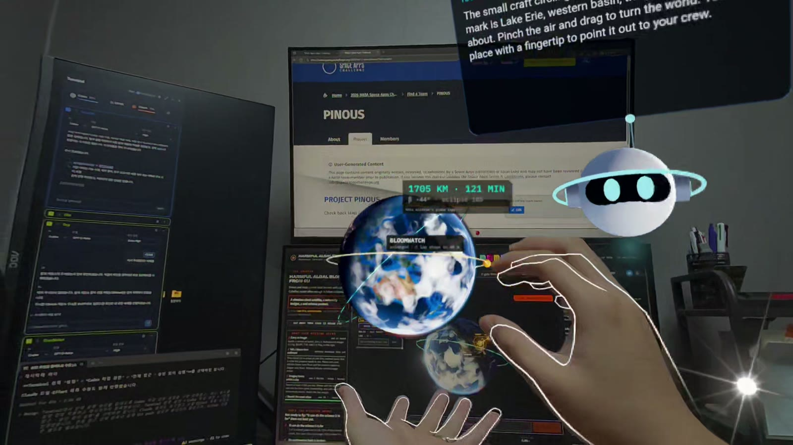
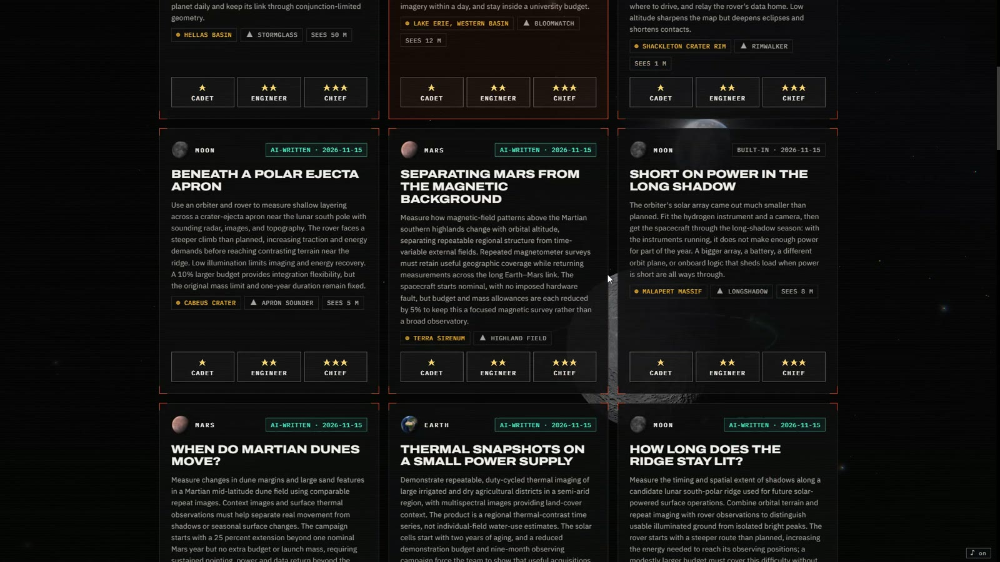
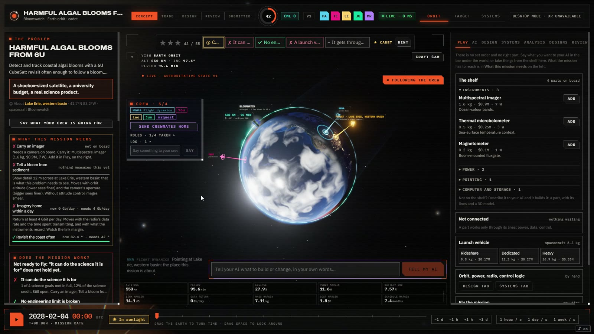
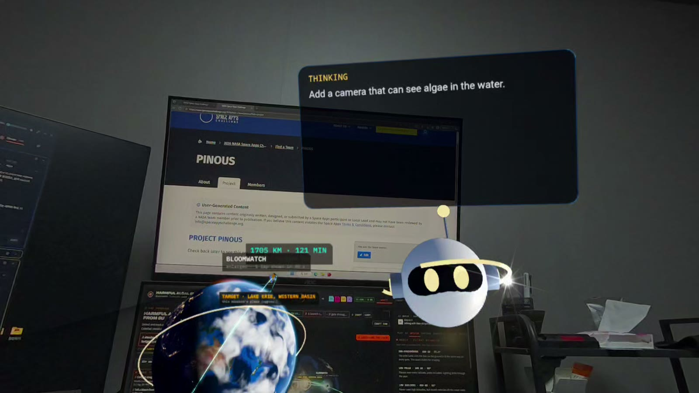
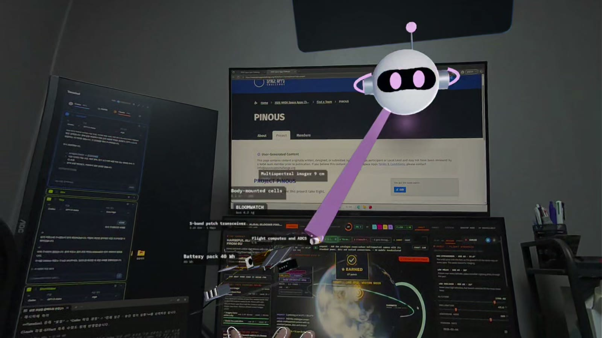
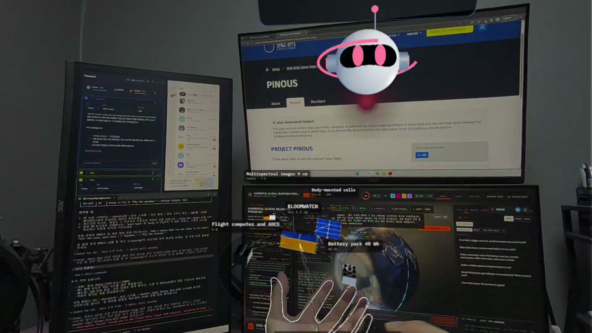
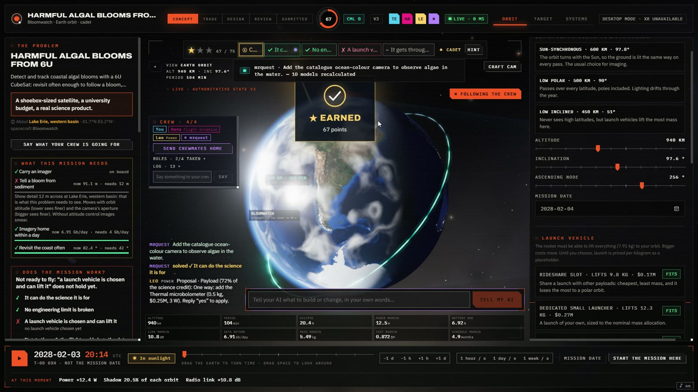
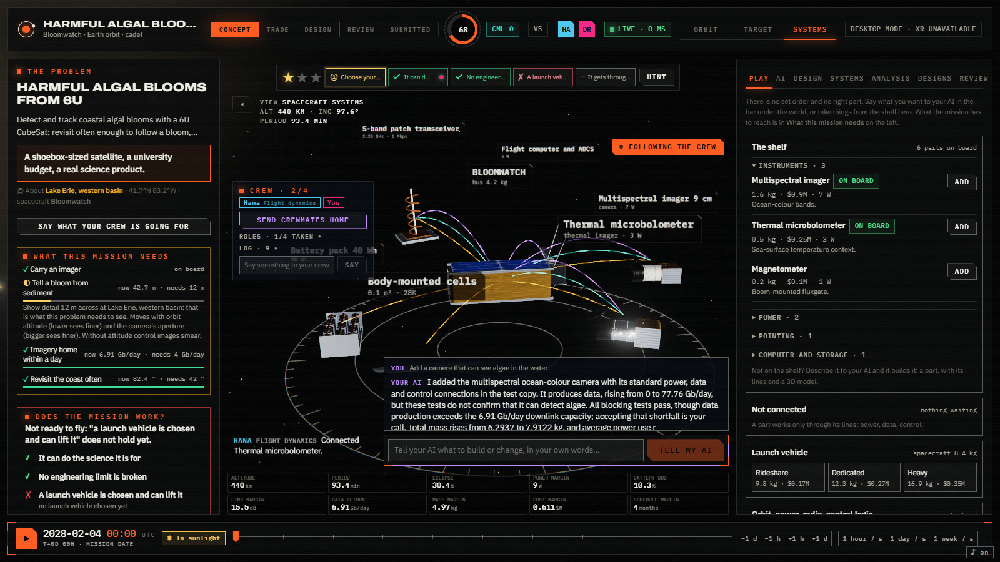
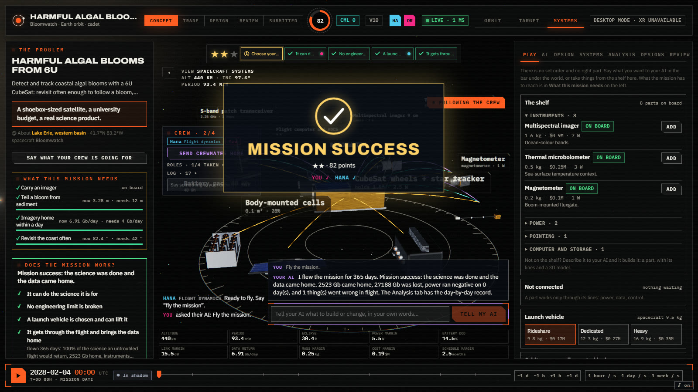
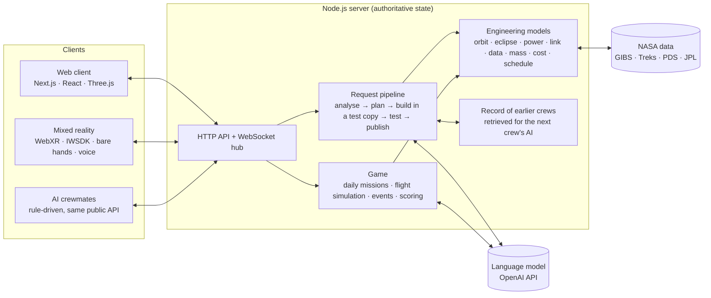

<h1 align="center">Mission Forge</h1>

<p align="center"><b>Space missions are hard. So we made one a game.</b><br>
A collaborative space-mission design game for the web and mixed reality.<br>
2026 NASA Space Apps Challenge · Challenge 13, <i>Space Mission Design Game</i></p>

<p align="center"></p>

<p align="center">
<a href="#the-game-in-pictures">The game in pictures</a> ·
<a href="#a-two-minute-tour">Tour</a> ·
<a href="#how-it-answers-the-challenge">Challenge fit</a> ·
<a href="#run-it">Run it</a> ·
<a href="#technical-overview">Technical overview</a> ·
<a href="#use-of-artificial-intelligence">Use of AI</a> ·
<a href="#nasa-data-and-resources">NASA data</a>
</p>

What makes it different:

- **Say it, and it is built.** The main control is plain speech. A player tells their AI what they want — a part, a
  method, an idea nobody listed — and the AI discusses it, explains what it costs, and builds it onto the spacecraft
  while the crew watches. The engineering models then show the consequence in mass, power, data and money.
- **No single right answer.** Nothing in the game picks the part for you. Hints lay out the ways through a problem
  and what each costs; the crew decides. A test-only solver proves every mission can be finished in several
  different ways.
- **A mission on your open hand.** In mixed reality (Meta Quest 3, bare hands, no controllers) the mission floats
  above your left palm. You turn the world with your fingers, point at a place on the planet, and speak. Close your
  hand and you are back at your desk.
- **A crew that can see each other.** Where one player points — a finger in the headset, a mouse on the web — shows
  up for everyone at the same spot on the planet or on the same part. A game chat records who asked for what and
  what was done, and each objective is credited to the crew member whose change solved it.
- **A world of its own for every mission, and a new mission every day.** Each mission has its own place on Earth,
  the Moon or Mars, drawn from NASA imagery and elevation data. A language model writes one new mission a day; what
  earlier crews found out is handed to the next crew's AI.

> This is an independent project and is not affiliated with or endorsed by NASA. The engineering models are
> first-order approximations with their assumptions stated; cost, schedule and launch-vehicle figures are game
> models, not estimates for any real programme.

## Why speech and mixed reality

We set out to build a simple game, and found that space engineering is not simple: a real mission is the balance of
hundreds of values. Instead of hiding that, the game lets players reach it in their own words. We did not want
players to tune battery figures until the numbers fit a prescribed answer; we wanted them to bring approaches we had
not thought of. So you say what you are thinking, and the AI debates it with you and turns it into hardware you can
see. Mixed reality is there for the same reason: with bare hands and a voice, a young student can hold a
spacecraft, turn a planet and say an idea out loud.

## The game in pictures

### 1. A board of missions, and a new one every day


Every card is a mission on Earth, the Moon or Mars, with its own place, science question and limits. A language model writes a new one each day; the built-in ones are always there. Each can be played at three levels: Cadet (hints come by themselves), Engineer (hints on request) and Chief (no hints, tight limits).

### 2. One screen for the whole mission


On the left, the problem and what the mission needs. In the middle, the world with the orbit and the target. On the right, the parts shelf and the launch vehicles. Along the bottom, ten live tiles for mass, power, budget, data, link and schedule: change one thing and every model that depends on it is recalculated.

### 3. Say it, and the AI builds it


The player taps their AI and speaks: "Add a camera that can see algae in the water." The AI works out what that means for this mission, builds the part in a test copy, checks it, and tells the player what it costs in mass, power and data.



Then the part is built onto the spacecraft in front of the player. Nothing in the game picks the answer: the player decides what to ask for, and several different designs can finish the same mission.

### 4. The mission on your open hand


On a Meta Quest 3, with bare hands: open the left palm and the mission rises above it, pinch to turn the world, touch the globe to point at a place. Close the hand and the desk is back. Mixed reality is here for access: a student who cannot read a link budget can still hold the spacecraft and say an idea out loud.



In the systems view the spacecraft comes apart: each part can be picked up, and its power, data and control lines are drawn.

### 5. A crew that sees the same thing, at the same moment


What the player in the headset did is on every teammate's screen at once: the change with their name, the objective it solved, the score. Where anyone points, with a finger or a mouse, everyone sees a mark in the same place.



Each crew member holds a role (power, communications, flight dynamics, payload) and answers for one priority. The game chat records who did what, and each objective is credited to whoever's change solved it. Empty seats can be filled by AI crewmates.

### 6. Fly it, and learn why


The flight is simulated day by day with seeded in-flight events. Four conditions with their evidence say whether it is a mission that works. The result is scored and ranked against other crews on the same mission, and kept as a record that the next crew's AI can draw on.

## A two-minute tour

1. Open the board, pick a mission and a level (★ Cadet, ★★ Engineer, ★★★ Chief).
2. Say what your crew is going for (the goal you choose decides which science counts most).
3. Tell your AI what to build: *"Add a camera that can see algae in the water."* The part appears on the
   spacecraft, already wired, and the tiles under the stage show what it cost.
4. The rest of the crew takes its roles — power, communications, flight dynamics, payload. Empty seats can be filled
   by AI crewmates, who do what a player in that role may do, through the same public API.
5. Point at the target on the planet. Everyone sees your mark.
6. Say *"Fly the mission."* A simulated flight runs day by day, with seeded in-flight events (a solar storm, a
   ground-station outage, a failed battery cell). The result says which of the four conditions held and why.
7. Change the design and fly again, save and compare designs, or submit and see where your crew stands among the
   crews that took the same mission.

## How it answers the challenge

| The challenge asks for | Where it is in the game |
|---|---|
| Design, manage and simulate a complete mission | Goal → spacecraft → instruments → orbit → launch vehicle → day-by-day flight → debrief and report |
| Individually or in teams of up to four | Four seats per mission; a fifth player is turned away. AI crewmates can fill empty seats for a solo player |
| Different roles, decisions made together | Role seats (power, communications, flight dynamics, payload, …). Each role answers for one priority; the crew scores a point for every priority that still holds at the end, and a change that breaks someone's priority is said out loud |
| Define an objective first | The crew writes what it is going for and picks a primary science goal (weighted ×1.5) and up to two stretch goals |
| Spacecraft components | Structure, solar arrays, batteries, radios and antennas, flight computer, attitude control, seven kinds of instrument, a rover. A part does nothing until its power, data and control lines are connected |
| Instruments with different characteristics | Mass, power, cost, data rate and science value per instrument; simple and advanced parts by level |
| Orbit options and what they mean | Named orbits per world with a plain explanation, plus altitude, tilt and plane. Eclipse, range, coverage and detail on the ground are recalculated on every change |
| Launch vehicles; mass and orbit compatibility | Three classes with capacity, price and lead time. Capacity drops for polar Earth orbits; a design the chosen vehicle cannot lift cannot fly |
| Mass, power, budget, time | Ten live tiles under the stage, each with a one-line explanation of why it moved. Time is both mission lifetime and the development schedule to the launch window |
| Every decision has a consequence | One change recalculates every model that depends on it, and the tiles that moved pulse |
| Rarely a single perfect solution | The crew sets its own goals; `tests/playability.test.ts` shows that each scenario at each level can be finished, and that crews choosing differently end with different designs |
| Feedback on why a mission succeeds or fails | Four conditions with their evidence come before the score: it can do its science, no limit is broken, it can be launched, it brings the data home |
| Scoring | Stars and a score from science value, margins, efficiency, rigour and crew coordination |
| Difficulty levels, scenarios | Three levels (hints come by themselves, on request, or not at all) and a board of missions on three worlds |
| Random events | Seeded in-flight events during the simulated flight; crews on the same mission meet the same ones |
| Dashboards, reports | Live dashboard, day-by-day flight record, evaluation dashboard and debrief |
| Save, share and compare designs | Named versions, sharing between crews, side-by-side comparison, JSON export |
| Competitive scenarios | A ranking per mission: crews that took the same mission are compared |
| Accessible to different levels of knowledge | Speech as the main control, plain-language explanations on every number, a first-visit walkthrough, hints that explain instead of answering |

## Run it

```bash
npm install && npm run install:web   # server and web client dependencies
npm run build:web                    # static build of the web client (apps/web/out)
npm run dev                          # http://127.0.0.1:8787
```

Node 22 or later. The first account to register becomes the platform administrator. State is kept in `.data/`.

A language model is optional. Copy `.env.example` to `.env` (which git ignores) and set `OPENAI_API_KEY` to enable
the conversational builder, daily missions and voice transcription. Without a key the game still plays: the parts
shelf, wiring, flight, scoring, collaboration and AI crewmates need no model, and a rule-based reader understands a
small set of sentences such as "fly the mission".

| Command | What it does |
|---|---|
| `npm test` | 159 unit and integration tests |
| `npm run e2e` | 51 browser checks in Edge/Chrome, including the WebXR emulator (run `build:web` first) |
| `npm run typecheck` | Server and web type checks |
| `node reports/tools/run-all-evidence.mjs` | Every check, on a fresh server without a language model; results in `reports/evidence/` |

### Put it online

The game needs a long-running Node server with WebSockets, so static or serverless hosting (Vercel, Netlify) cannot run it. `render.yaml` describes it as one web service for [Render](https://render.com): New + → Blueprint → this repository. Any host that runs a Node process works the same way: build with `npm install && npm run install:web && npm run build:web`, start with `HOST=0.0.0.0 npm start`, and the server listens on `PORT`.

On a free instance the state in `.data/` is lost when the service restarts. The first account to register is the administrator, so register yours first. Leave `OPENAI_API_KEY` unset on a public server unless you accept that every visitor's requests are billed to it.

### Mixed reality

| How | Where to open it | What it shows |
|---|---|---|
| Emulator | Add `&iwer=1` to a mission URL in a desktop browser and press **Enter MR** | Session entry, spatial panels, grabbing. No passthrough or hand tracking |
| Quest 3 over USB | `adb reverse tcp:8787 tcp:8787`, then `http://localhost:8787` in the headset's browser | Everything |
| Quest 3 over Wi-Fi | `HOST=0.0.0.0` with `TLS_CERT_FILE` and `TLS_KEY_FILE`, then `https://<PC address>:8787` | Everything (WebXR needs HTTPS) |

In the headset: open your left palm and the mission rises above it; make a fist and it is gone. Pinch the world to
turn it, pinch with both hands to move and scale, touch the globe with a fingertip to point, and open your right
palm for the tool panels.

## How it is built

```
apps/web/        Next.js 16 + React 19 + Three.js + IWSDK (static export, served by the same server)
  lib/scene/     planets from NASA imagery and elevation, spacecraft models, orbit / systems / target views
  lib/xr/        the WebXR workspace: hands, gestures, spatial panels, voice
src/
  server/        HTTP API and the WebSocket collaboration hub (the server holds the authoritative state)
  platform/      accounts, sessions, roles, audit log, AI crewmates
  pipeline/      a request in words → analysis → plan → build in a test copy → preview → approval → publish
  science/ nasa/ orbit, power, link and rover models, a J2 propagator, terrain, imagery, GMAT script export
  game/          scenarios, daily missions, the day-by-day flight, in-flight events, scoring
  knowledge/     the record of what earlier crews found, retrieved for the next crew's AI
```

Clients send intent; the server validates it, recalculates the models and broadcasts a new version to everyone.
Anything a language model writes is treated as data: it is schema-checked, built in a test copy, tested, and
published only after it passes (and, where it changes the shared design beyond a player's rights, after the lead
says yes). Generated control logic runs in a sandbox (QuickJS/WASM) with limits; no model output is executed
directly in the shared mission.

## Technical overview

There is no hosted instance: the whole game, server included, is in this repository and runs on one machine with the three commands above. A headset on the same network (or over USB) connects to that machine.



**One source of truth.** Clients send intent (an edit, a request in words, where they are pointing). The server validates it, applies it to the mission's current version, recalculates only the models that depend on what changed, and broadcasts the new version to every client in the mission. Two people changing the same value at once: the later one is turned back with the current value; changes to different values merge.

**From a sentence to hardware.** A request in words goes through a fixed pipeline: read the mission's state, analyse the request (with passages retrieved from the record of earlier crews), find the capabilities that can do it, plan, build the change in a test copy of the mission, run the engineering checks on that copy, and publish it to the shared mission (after the lead's approval where the change needs it). What a language model writes is data for this pipeline: it is validated against a schema, and generated control logic runs in a QuickJS/WebAssembly sandbox with time and memory limits. Model output is never executed directly.

**Engineering models.** Two-body orbits with a J2 propagator for comparison, eclipse fraction, solar array and battery sizing, link budget with pointing loss, data produced against data sent down, mass and launch capacity (including the loss for polar orbits), a development schedule, and a day-by-day flight with seeded events. These are deterministic and tested against reference values; they are first-order models, and cost, schedule and launch figures are game models.

**Mixed reality.** One Three.js scene serves both the desktop page and the headset (`immersive-ar`, falling back to `immersive-vr`). Hands are read from WebXR hand tracking: palm orientation to summon the mission, pinch to turn and scale, a fingertip on the globe to point. Speech is recorded in the headset and transcribed on the server.

**Data.** Planet imagery and elevation are fetched from NASA services through an allow-listed proxy and cached on disk. State is kept as versioned JSON under `.data/`; an audit log is hash-chained. Secrets are read from the environment only.

**Tests.** 159 unit and integration tests (`npm test`), 51 browser checks including the WebXR emulator (`npm run e2e`), and scripted play-throughs whose output is kept under `reports/evidence/`.

## Use of artificial intelligence

- **In the game.** A language model (OpenAI API; the model is set by `OPENAI_MODEL`) reads players' requests, plans
  the change, writes onboard control rules and the shape programs that are compiled into 3D parts, writes one new
  mission brief a day, and words the answers. The numbers in an answer always come from the engineering models, not
  from the language model, and answers are labelled accordingly. Speech in the headset is transcribed with an OpenAI
  transcription model. A model's judgement is never presented as scientific validation.
- **AI crewmates.** Empty seats can be filled by AI crewmates. They are rule-driven software players (they do not
  call a language model) that act through the same public API as a person, and their accounts are named "… · AI".
  The browser has a recording mode (`?cast=1`) that draws crew names without that suffix; **in the demo video the
  seats other than the author's are played by these AI crewmates.**
- **In development.** Most of the code, tests and documentation in this repository were written with an AI coding
  assistant (Anthropic Claude, through Claude Code) under the author's direction, and reviewed and tested by the
  author. Commits made this way carry a `Co-Authored-By` line.
- The narration of the demo video is an AI-generated voice (OpenAI text-to-speech), and the video says so on screen. No AI-generated images or video are used. Planet surfaces come from NASA data; sounds are synthesised in
  the browser; 3D parts are assembled from primitives by a deterministic compiler.

## NASA data and resources

| Resource | Used for |
|---|---|
| NASA GIBS — Blue Marble shaded relief and bathymetry; VIIRS city lights 2012 | The Earth, day and night |
| NASA Solar System Treks — LRO LROC WAC global mosaic; Viking MDIM 2.1 colour mosaic | The Moon and Mars |
| NASA PDS Geosciences Node — LRO LOLA LDEM_4; MGS MOLA MEGDR | Elevation of the Moon and Mars (regional scale: about 7.6 km and 14.8 km per pixel) |
| NASA/JPL Solar System Dynamics — approximate positions of the planets; JPL Horizons | Where the Sun, Earth, Moon and Mars are at the mission's date |
| NASA General Mission Analysis Tool (GMAT) | Export of a mission's orbit as a GMAT script, import of GMAT report files (generated scripts have not been run in GMAT here) |
| NASA Systems Engineering Handbook (SP-2016-6105 Rev 2); NPR 7120.5 | Life-cycle phases and reviews behind the game's stages |
| NASA Small Spacecraft Systems Virtual Institute — *Design and Develop Science Missions* (Access to Space for All webinar, 2025) | The four mission segments and the six-step design sequence in the mission guide |
| NASA CubeSat Launch Initiative — *CubeSat 101* | The 6U CubeSat scenario and its limits |
| NASA GSFC Mission Design Lab (Integrated Design Center) | The discipline seats |
| JPL — Wessen et al., *Space Mission Concept Development Using Concept Maturity Levels* | The concept-maturity gauge (a teaching aid, not a formal review) |

Imagery and elevation credits: NASA/GSFC/Arizona State University (LROC), NASA/GSFC/MIT (LOLA), NASA/JPL/USGS
(Viking MDIM 2.1), NASA/GSFC (MOLA), NASA Earth Observatory (Blue Marble, VIIRS).

## What has and has not been verified

Checked on 2026-11-15; commands and full output are in `reports/evidence/`.

- 159 unit and integration tests and 51 browser checks pass on a server without a language model.
- With the real language model: a request in words adds a part and publishes it; a launch vehicle is chosen by
  speech; the mission is flown by speech; a custom part with a generated 3D model is built; a full mission is played
  from a first request to "Mission success" with three AI crewmates.
- On a real Quest 3 with bare hands: entering mixed reality, the mission on the left palm, turning and scaling by
  pinch, the tool panels.
- **Not verified on the real headset:** several later hand gestures and visuals, and the headset microphone
  (transcription was verified from a recorded clip). Other mixed-reality checks ran in the WebXR emulator, which has
  no passthrough, hand tracking or device frame rate.
- Latency figures are loopback values on one PC. GMAT scripts were not run in GMAT.

Known limits: all missions are orbiters with an optional rover; the flight is simulated in daily steps and shown as
a result, not played through; control logic runs once per simulated day; the interface is in English.

## License

Apache License 2.0 — see [LICENSE](LICENSE). NASA imagery and data are in the public domain and are credited above.
