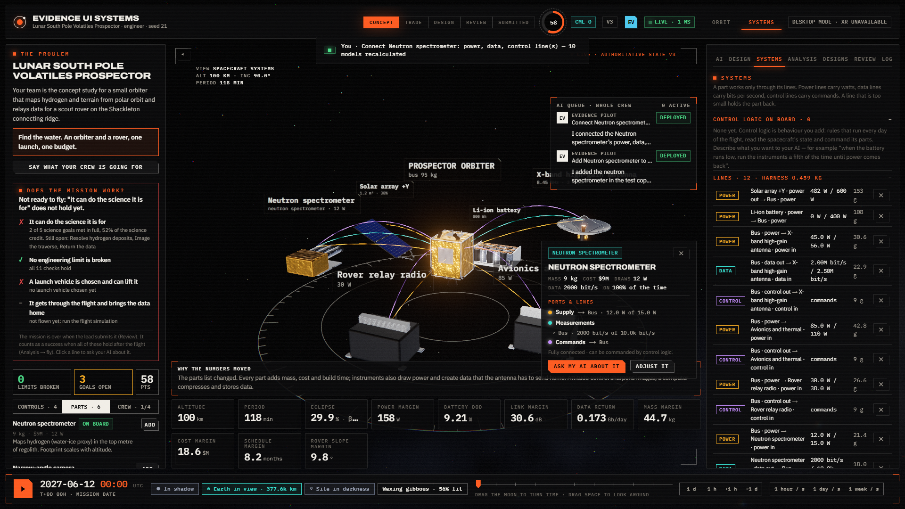
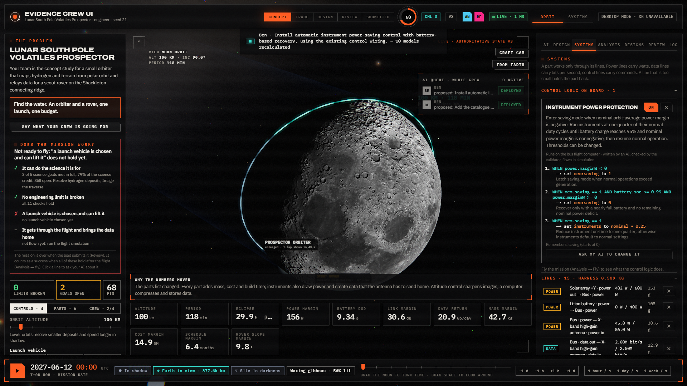
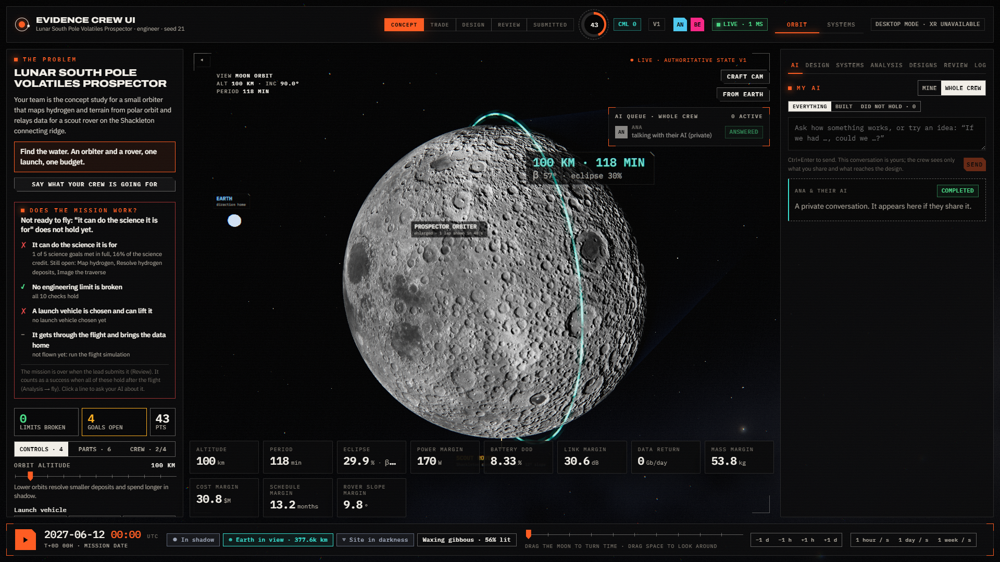
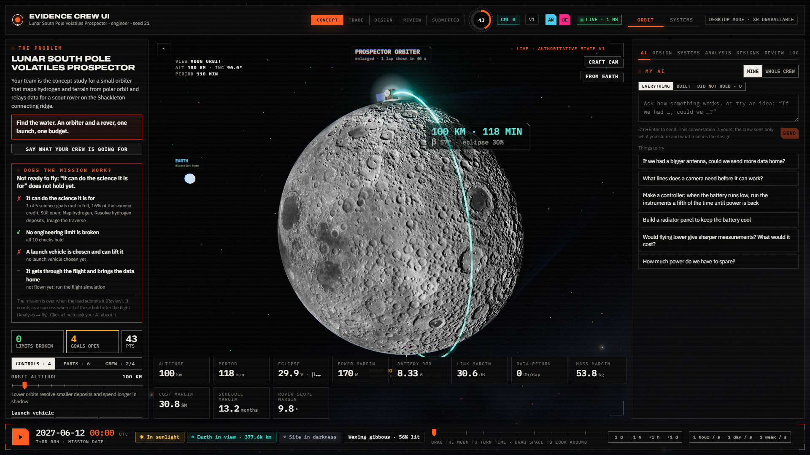
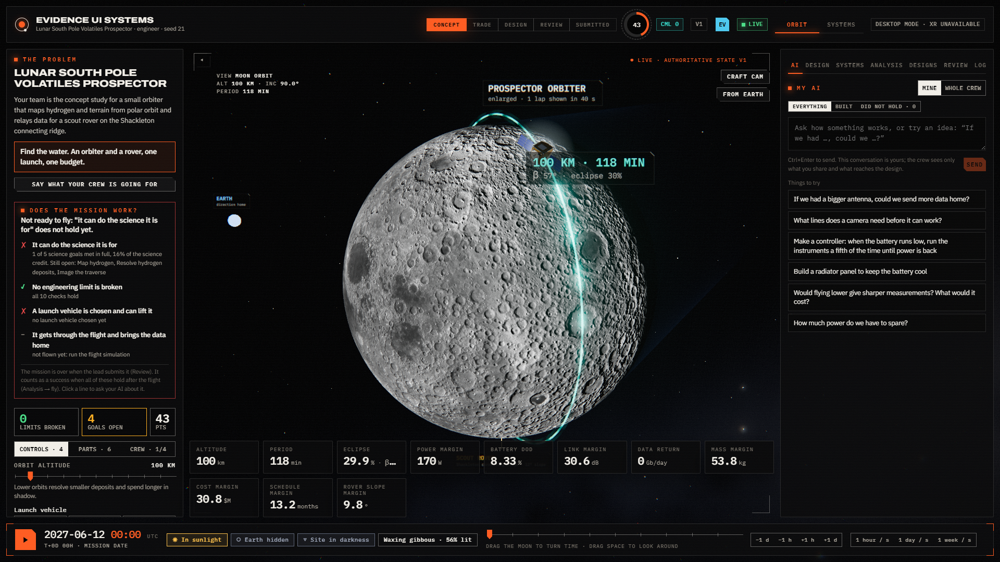
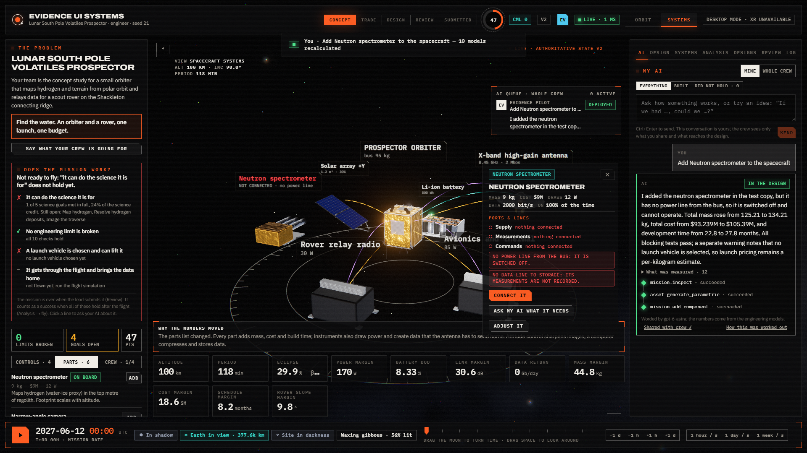
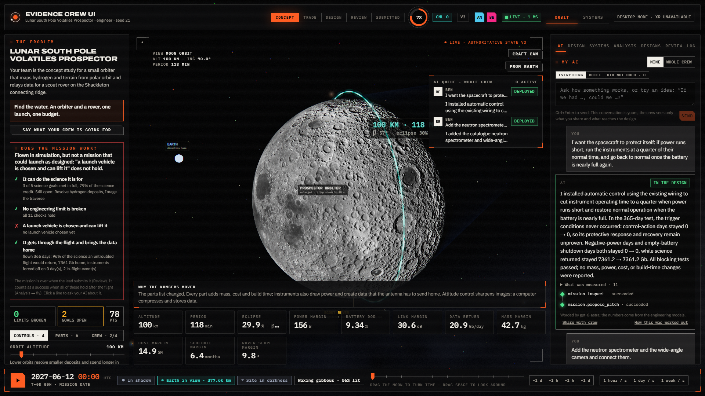
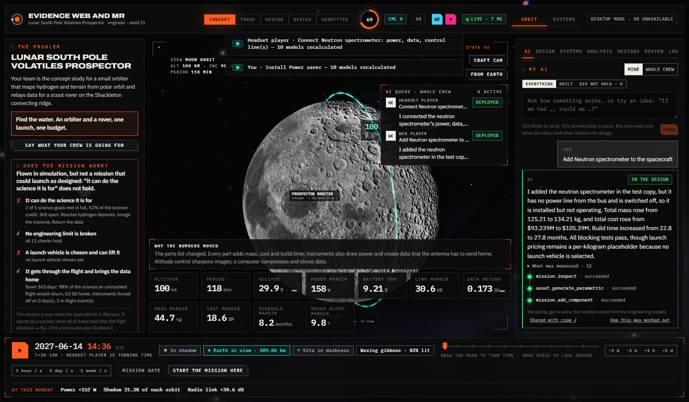
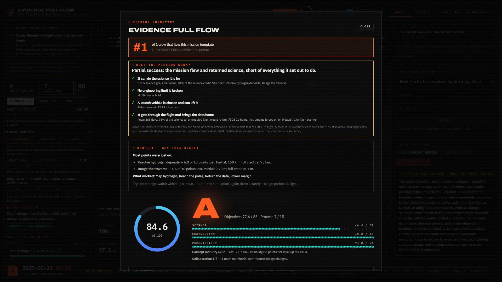

# Pinous — Mission Forge 최종 개발 보고서

2026 NASA Space Apps Challenge · Space Mission Design Game · Web + MR 협동 AI 엔지니어링 게임
보고서 생성 시각: 2026-11-15 01:01 KST

이 문서는 2026-11-14 밤부터 2026-11-15 아침까지 실제로 수행한 작업의 결과 보고서다. 실행하지 않은 기능이나 측정하지 않은 수치는 적지 않았다. 검증하지 못한 항목은 14장에 따로 적었다.

## 1. 작업 시각, 실행 환경, 코드 버전

| 항목 | 값 |
|---|---|
| 시작 시각 (시스템 시계) | 2026-11-14 23:06:46 KST |
| 종료 목표 | 2026-11-15 08:00:00 KST |
| 실행 환경 | Claude Code CLI 2.1.323, Windows 11, 대화형(사용자 참석) 세션 1개 |
| 프로젝트 경로 | `C:\Users\dlfgu\Documents\GitHub\NASA_Hack` |
| 기준 커밋 | `d759b5b` (현재 HEAD `d759b5b`) — 이후 변경 78개 경로는 **커밋하지 않은 작업 트리**에 있다. 커밋·푸시는 사용자 요청 시에만 한다는 기존 지시를 따랐다. |
| 런타임 | Node 24.15, TypeScript, Next.js 16 정적 빌드, three.js, IWSDK(WebXR) |
| 게임 AI 모델 | OpenAI `gpt-6-astra` (서버 `.env`의 키 사용, 저장소·번들·이 문서에 키 없음) |

## 2. 요구한 제품과 실제 구현한 플레이 흐름

**요구**: 최대 4명이 Web 또는 MR로 같은 우주 임무에 접속해, 각자의 AI 엔지니어와 자연어로 가설을 논의하고, 필요한 장비·회선·제어 로직을 실행 중에 만들고, 공동 시뮬레이션으로 검증해 임무를 완수하는 협동 게임.

**구현된 흐름** (모두 실제 UI 또는 API로 실행해 확인함):

1. **임무 도착** — 미션을 만들면 세계(천체·궤도·지상국), 한도(질량·예산·일정), 목표, 우주선, 부품, 포트, 회선이 **이미 연결된 상태**로 온다. 문제 설명과 그 문제에 맞는 조절값·부품·역할(킷)이 함께 온다.
2. **임무 정의** — 승무원이 무엇을 위한 임무인지, 무엇이 1순위인지 정한다.
3. **설계** — 부품을 추가하면 **미연결** 상태로 올라온다. 전력선·데이터선·제어선을 연결해야 동작한다. 장비를 달면 질량·전력·데이터·비용·일정·발사 여유가 함께 바뀐다.
4. **개인 AI와 가설 논의** — 각자 자기 AI에게 묻는다. 타당하면 AI가 시험용 사본에 만들어 계산 결과를 보여 주고, 틀리면 이유와 대안을, 모델 밖이면 한계를 말한다. 대화는 본인이 공유하기 전까지 비공개다.
5. **제어 로직 생성** — "전력이 모자라면 관측을 줄였다가 회복되면 되돌려" 같은 문장으로 AI가 온보드 제어 규칙을 만든다. 제안 전에 같은 조건으로 실제 비행시켜 전후를 비교한다.
6. **비행** — 하루 단위 임무 시뮬레이션. 시드로 정해지는 비행 중 사건(태양전지 스트링 고장, 지상국 중단 등)을 만나고, 제어 로직이 매일 실행된다.
7. **판정과 제출** — "임무가 성립하는가"가 조건별 근거와 함께 먼저 나오고, 점수는 그 다음이다.

| 구분 | 내용 |
|---|---|
| 서로 다른 미션 | 달 남극 휘발성 물질 탐사(궤도선+로버), 지구 저궤도 6U 큐브샛, 화성 기상·중계 궤도선 — 천체·한도·부품 목록·목표·사건이 다르다 |
| 협업 | 방당 최대 4명, 서버가 상태와 권한을 판정, WebSocket 실시간 동기화 |
| 클라이언트 | 같은 페이지가 데스크톱 브라우저와 WebXR 몰입 세션을 모두 제공 |

## 3. 요구사항별 구현 위치, 상태, 검증 결과

53개 항목: PASS 52 · 외부 차단 1

상태 구분: PASS(필요한 실행 검증 통과) · 구현·미검증 · FAIL · 외부 차단 · 미구현. 외부 차단과 미검증은 PASS로 세지 않았다.

| ID | 요구사항 | 구현 위치 | 사용자 조작 경로 | 검증 방법 | 실제 결과 | 증거 | 상태 |
|---|---|---|---|---|---|---|---|
| R-OPS-01 | 08:00 KST까지 세션을 이어 가는 장치를 구성하고 실제로 검증 | .claude/settings.json, .claude/nightshift-stop.cjs | (operator) create NIGHTSHIFT_STOP to stop | Pipe test of the hook for continue / other session / stop file; in-session probe that project hooks load | Stop 훅을 가짜 입력으로 시험(계속/다른 세션 통과/중지 파일 통과)하고, 같은 설정 파일의 임시 프로브가 이 세션에서 발화함을 확인. 프로세스 종료·사용량 한도는 다루지 못함 | WORK_LOG.jsonl (stop-hook lines) | **PASS** |
| R-OPS-02 | 요구사항 추적표와 상태 파일을 유지 | requirements.json, WORK_STATE.json, WORK_LOG.jsonl, NIGHTSHIFT_BRIEF.md, docs/ADDED_DECISIONS.md | - | Files exist and are updated as work proceeds | requirements.json(53항목), WORK_STATE.json, WORK_LOG.jsonl, NIGHTSHIFT_BRIEF.md, ADDED_DECISIONS.md, reports/evidence/ 를 작업 내내 갱신 | requirements.json; WORK_LOG.jsonl | **PASS** |
| R-FLOW-01 | 목표→요구조건→설계→상충관계→제작·연결·제어→시험→비행·운영→장애 대응→과학 성과까지 하나의 흐름 | apps/web/app/mission/page.tsx, src/platform/sessions.ts | Lobby → mission → define → design → My AI → Fly → Submit | Browser E2E through the whole flow | 실제 UI로 전체 흐름 1회 완주(16개 검사), API로 다른 두 미션 완주 | reports/evidence/ui-fullflow.md; reports/evidence/play-*.md | **PASS** |
| R-FLOW-02 | 장비 추가가 전력·질량·데이터·비용, 나아가 통신·발사·일정에 연쇄 영향 | src/state/recalc.ts | Parts → Add → Connect; watch goals and limits | Unit test + API test of derived results before/after | 장비 2개 추가 한 번에 하네스·총질량·부하·전력 여유·방전 깊이·데이터 생성량·비용(상한 0.3M 초과)·일정·발사 여유가 함께 변함 | reports/evidence/e05-e06-build-control.md | **PASS** |
| R-PKG-01 | 미션이 만들어진 상태로 시작: 목표·한도·환경·부품·포트·회선·초기 상태·문제·조절값(단위·범위) | src/game/scenarios.ts (generateMission → prewire), src/game/briefs.ts (kit), src/systems/graph.ts | Create mission in lobby; open it | Unit test: every scenario is wired, validated and playable at start | 미션 생성 시 모든 초기 부품을 자동 배선, 킷(조절값·부품·역할) 포함, 시작 시 배선 검사 통과 | tests/systems.test.ts; reports/evidence/play-*.md | **PASS** |
| R-PKG-02 | 생성 후 미션 패키지 검증(스키마·ID·단위·연결·실행 가능성·목표 판정) | src/state/schema.ts parseMissionConfig, src/systems/graph.ts systemsIssues, tests/playability.test.ts | - | Unit tests | 스키마+참조+배선+제어기 검증을 모든 생성 미션에 적용, 전 시나리오·난이도 완주 가능 테스트 통과 | tests/playability.test.ts; tests/systems.test.ts | **PASS** |
| R-PKG-03 | 미션마다 세계·한도·규칙이 실제로 다름 | src/game/scenarios.ts | Create missions from different briefs | Unit test + API: three scenarios, different bodies, catalogues, objectives, events | 세 미션이 천체·버스·한도·기간·지상국·부품 목록·목표·사건·결과에서 다름(큐브샛 vs 화성 실행) | reports/evidence/play-leo-cubesat.md; reports/evidence/play-mars-weather-relay.md | **PASS** |
| R-AI-01 | 플레이어마다 독립된 AI 대화 문맥 | src/pipeline/service.ts conversation(), src/pipeline/requirements.ts | My AI panel: ask, then follow up with 'do it' | Unit test with a scripted model + live model dialogue | 프롬프트에 그 플레이어의 이전 문답만 들어감을 단언. 실제 모델이 4번째 요청에서 3번째에 만든 제어기를 이어서 수정 | tests/crew-ai.test.ts; reports/evidence/e05-e06-build-control.md | **PASS** |
| R-AI-02 | 개인 AI 대화는 기본 비공개, 공유 세계 변경은 모두에게, 본인이 공유 가능 | src/pipeline/privacy.ts, src/server/http.ts, src/server/collab.ts | My AI → Share with crew | API + WebSocket test with two accounts | 브라우저 2개: 상대에게는 '비공개 대화' 표식만 보이고 내용 없음, 공유 후 열람 가능. HTTP·WebSocket 가림은 테스트로 확인 | reports/evidence/ui-crew.md; reports/evidence/ui/11-private-conversation-other-player.png, 12-shared-conversation.png; tests/crew-ai.test.ts | **PASS** |
| R-AI-03 | AI가 답하기 전에 실제 세계(구성·계산 결과·배선·부품 목록·목표)를 읽음 | src/pipeline/requirements.ts analyzeOnce, src/platform/sessions.ts aiContext | Ask 'why is data not coming down?' | Live model dialogue | 실제 모델 답변이 현재 수치(데이터량, 링크 여유, 저장 공간, 부품 가격)를 인용 | reports/evidence/e04-e06-control.md | **PASS** |
| R-AI-04 | 가설 처리: 타당→제작·측정, 틀림→이유와 대안, 모델 밖→한계 명시 | src/pipeline/requirements.ts, src/pipeline/answer.ts | Ask 'if we had X could we Y?' | Live model dialogue (E07, E08) | 타당한 아이디어는 제작·측정, 틀린 아이디어는 수치와 대안으로 거부, 모델 밖은 한계 명시, 없는 신호를 쓰는 제어기는 제안까지 가지 못함 | reports/evidence/e07-e08-e17-mars.md; reports/evidence/e05-e06-build-control.md; tests/crew-ai.test.ts | **PASS** |
| R-AI-05 | '만들었다'는 실제 객체 ID·적용 변경·측정 결과를 뜻함. 변경 요약과 되돌리기 제공 | src/pipeline/answer.ts composeBuildReply, sessions.rollback | My AI reply shows what changed; Log → roll back | API test + browser | 답변에 전→후 수치, 제안에 생성된 ID(부품·선·제어기) 나열, Log 탭의 이전 버전 되돌리기 테스트 통과 | reports/evidence/e05-e06-build-control.md; tests/platform.test.ts | **PASS** |
| R-AI-06 | 검증 실패 시 AI가 원인을 분석해 재시도 | src/pipeline/requirements.ts analyze (dry run + repair, max 2) | - | Unit test with a scripted model that first returns an invalid line | 거부된 선이 검증 사유와 함께 모델에 돌아가 수정안이 수락됨(repairs=1), 3회 거부 시 사유와 함께 정직하게 실패 | tests/crew-ai.test.ts | **PASS** |
| R-BUILD-01 | 부품은 ID·타입·포트·단위 있는 속성·상태·제약·연결·이력·근거를 가진 실행 가능 구성요소 | src/state/schema.ts, src/systems/graph.ts portsOf/describePart | Select a part → part card | Unit test + browser | 실제 UI의 부품 카드가 포트별 종류·단위·연결된 선·정격 대비 흐름을 표시, 열린 포트는 경고 | reports/evidence/ui-systems.md; reports/evidence/ui/02-part-unconnected.png, 04-part-connected.png | **PASS** |
| R-BUILD-02 | 회선이 실제 흐름(전력 W·데이터 bit/s·제어)을 전달, 비호환 포트 차단, 정격 부족 시 제한 | src/systems/graph.ts | Part card → Connect; AI adds a line | tests/systems.test.ts | 미연결 부품은 부하·데이터 0, 전력만 연결하면 기록 없음, 비호환 연결은 이유와 함께 거부, 3배 키운 태양전지판은 선 교체 전까지 잘림 | tests/systems.test.ts (wiring, 5 tests) | **PASS** |
| R-BUILD-03 | AI가 만든 제어 로직이 새 동작으로 실제 실행되어 데이터·전력 결과를 바꿈 | src/systems/controller.ts, src/systems/expr.ts, src/game/simulation.ts | Ask AI for a controller → approve → Fly | tests/systems.test.ts + live model | 단위 테스트와 실제 모델 실행 모두에서 제어기 설치 시 비행 지표가 변함 | tests/systems.test.ts; reports/evidence/e05-e06-build-control.md | **PASS** |
| R-BUILD-04 | 안전: 스키마·타입·단위 검사, 실행 제한, 파일·네트워크·비밀 접근 불가, 적용 전 시험, 원자적 적용, 롤백, eval 금지 | src/systems/expr.ts (own parser, bounded), src/pipeline/proposals.ts (flight test), src/state/store.ts | - | tests/systems.test.ts hostile expressions; tests/sandbox.test.ts | 적대적 식을 파서가 거부, 없는 신호의 제어기는 제안 불가, 새 제어 로직은 제안 전 비행 시험, 버전 저장소로 원자적 반영 | tests/systems.test.ts; tests/crew-ai.test.ts | **PASS** |
| R-SIM-01 | 결과는 LLM이 아니라 권위 있는 엔진이 계산 | src/state/recalc.ts, src/game/simulation.ts, src/game/scoring.ts | - | Code + tests | 점수·검사·판정·비행 지표는 recalc/simulation/scoring에서 계산, 모델은 문장만 작성 | src/game/scoring.ts; tests/*.test.ts | **PASS** |
| R-SIM-02 | 재현성: 같은 설계·시드·사건이면 같은 비행 | src/game/simulation.ts, src/game/events.ts | Fly twice | tests/systems.test.ts, tests/game-design.test.ts | 반복 실행 시 지표 완전 일치 | tests/systems.test.ts, tests/game-design.test.ts | **PASS** |
| R-SIM-03 | 시뮬레이션 시간(속도·정지·단계·재실행)을 승무원이 공유 | apps/web/components/MissionClock.tsx, src/server/collab.ts clock relay | Clock deck | Browser E2E with two clients | 재생/정지, 3단 배속, ±1시간/±1일 단계(브라우저에서 정확히 하루 이동), 한 사람의 시계가 나머지 3명에게 전달, 비행 결과 공유·재현 | reports/evidence/ui-fullflow.md; reports/evidence/four-clients.md | **PASS** |
| R-SIM-04 | 같은 조건에서 설계 전후 저장·비교, 실패한 가설을 이유와 함께 보존 | src/platform/sessions.ts saveDesign/compare, hypotheses log | Designs tab; Crew log | API test + browser | 저장한 두 설계를 나란히 비교(14행), AI가 거부한 아이디어는 'Did not hold'에 이유와 함께 남고 공유 가능 | reports/evidence/ui-fullflow.md; tests/crew-ai.test.ts | **PASS** |
| R-SIM-05 | 임무 달성 여부와 근거를 먼저, 점수는 보조. 게임 가정 표시 | apps/web/components (MissionOutcome) | Top of the left column; debrief | Browser | 'Does the mission work?' 네 조건과 근거가 왼쪽 패널과 디브리프에서 점수보다 위, 기준은 게임 규칙으로 명시 | reports/evidence/ui-crew.md; reports/evidence/ui/10-outcome-first.png, 14-outcome-after-flight.png | **PASS** |
| R-XR-01 | Web과 MR이 같은 미션·객체·배선·시뮬레이션을 공유 | apps/web/lib/xr/workspace.ts | Enter XR | IWER emulator E2E (not a physical headset) | 같은 페이지·같은 상태·같은 엔진. WebXR 에뮬레이터에서 양방향 13개 검사 통과. 검증 수준: 에뮬레이터 | reports/evidence/xr-loop.md | **PASS** |
| R-XR-02 | 개인 시점(카메라)은 공유하지 않고 설계 상태만 공유 | apps/web/lib/collab.ts | Rotate the view in one client | Browser E2E | 카메라는 전송되지 않음. 존재·설계 편집·시계만 공유(브라우저 2개 실행) | reports/evidence/ui-crew.md | **PASS** |
| R-XR-03 | 실물 MR 헤드셋에서 검증 | - | Quest browser | Needs hardware | 이 세션에서는 실물 헤드셋을 조작할 수 없음. 추적·패스스루·손 입력·프레임률·착용감 미검증 |  | **외부 차단** |
| R-MP-01 | 최대 4명: 참가·이탈·재접속과 상태 복원 | src/server/collab.ts, src/platform/sessions.ts | Lobby → join | tests/platform.test.ts + four-client run | 3명 참가, 5번째는 409로 거부, 끊겼다 돌아온 클라이언트는 현재 버전으로 복원 | reports/evidence/four-clients.md; tests/platform.test.ts | **PASS** |
| R-MP-02 | 순서·버전·중복 방지·충돌 처리·버전 변경 시 AI 재검증 | src/state/store.ts, src/pipeline/proposals.ts | - | tests/platform.test.ts | 같은 값 동시 편집은 하나만 적용되고 상대에게 알림, 다른 값은 둘 다 적용, 잘못된 선은 전원에게 거부, 제안은 미션이 바뀌면 다시 평가 | reports/evidence/four-clients.md; tests/platform.test.ts | **PASS** |
| R-MP-03 | 4 클라이언트의 동기화 지연과 상태 일치를 측정 | reports/tools/fourclients.mjs | - | Measured run | 루프백 n=72: 편집 전송→다른 클라이언트 수신 중앙값 4.3 ms, p95 6.8 ms, 최대 7.5 ms(재계산 포함), 상태 해시 일치 | reports/evidence/four-clients.md | **PASS** |
| R-MP-04 | 누가 무엇을 바꿨는지 이력과 되돌리기 | src/state/store.ts, audit | Log tab | tests/platform.test.ts | 작성자·요약이 있는 버전 이력, 되돌리기는 리드만 가능하고 감사 기록됨 | tests/platform.test.ts | **PASS** |
| R-UX-01 | 처음 온 사용자가 임무, 문제, 바꿀 수 있는 것, AI에게 물을 것, 변경의 효과, 종료 조건을 바로 이해 | apps/web/components/MissionProblem.tsx, MissionPanels.tsx | Open a mission | Browser screenshots | 첫 화면에 문제와 핵심, 임무 성립 여부와 부족한 것·종료 조건, 조절값/부품/역할 킷, 예시 질문이 있는 My AI, 7단계 안내 | reports/evidence/ui/30-first-screen-with-walkthrough.png; reports/evidence/ui-fullflow.md | **PASS** |
| R-UX-02 | 반응 없는 버튼, 설명 없는 숫자, 설명 없는 회전, 가짜 진행률이 없음 | apps/web | - | Browser pass + console error check | 리드와 두 번째 멤버로 전 탭 점검(18개 화면): 이름 없는 컨트롤 0, 이유 없는 비활성 0, 페이지 오류 0. 이유 없는 버스 회전 제거, 우주선 표시 속도 표기 | reports/evidence/ui-buttons.md | **PASS** |
| R-SVC-01 | 계정·API·장비 조사, .env.example과 README가 코드와 일치, 비밀값이 저장소·번들·로그·보고서에 없음 | .env.example, README.md, report | - | grep for secrets; read config code | .env.example을 코드가 실제로 읽는 변수로 다시 작성(공개/비밀 표시), .env는 git 제외, 추적 파일·증거·보고서에 키 문자열 없음 | .env.example; reports/evidence/report-check.json | **PASS** |
| R-DOC-01 | 자율 추가 사항을 이유·대안·영향·검증과 함께 기록 | docs/ADDED_DECISIONS.md | - | File review | 13개 결정 기록 | docs/ADDED_DECISIONS.md | **PASS** |
| R-RPT-01 | 최종 보고서 .md와 한글이 깨지지 않는 .pdf를 실제 렌더링해 확인 | reports/Pinous_Final_Development_Report_2026-11-15.{md,pdf} | - | Render and inspect pages | 보고서를 .md와 .pdf로 생성. PDF 점검: 쪽수, 한글 텍스트 추출, 깨진 이미지 0, 넘치는 표 0, 빈 쪽 0, 비밀값 형태 문자열 0. 쪽 그림을 직접 확인 | reports/Pinous_Final_Development_Report_2026-11-15.pdf; reports/evidence/report-check.json; reports/evidence/report-pages/ | **PASS** |

### 필수 검증 시나리오 E01–E19

| ID | 요구사항 | 구현 위치 | 사용자 조작 경로 | 검증 방법 | 실제 결과 | 증거 | 상태 |
|---|---|---|---|---|---|---|---|
| E01 | 새 미션에서 환경·시스템·제약·목표가 자동 구성 |  |  | Recorded scenario run | 세계·한도·목표·부품·포트·회선(모두 연결)·검사·문제 설명·킷이 함께 도착 | reports/evidence/play-leo-cubesat.md; reports/evidence/ui/01-mission-start.png; tests/systems.test.ts | **PASS** |
| E02 | 실제 UI로 설계부터 운영·평가까지 진행 |  |  | Recorded scenario run | 1인, 실제 UI 클릭·입력, 실제 모델: 정의→부품 2개→연결→AI 제어 로직→거부된 아이디어→발사체→시계 단계→비행→설계 비교→리뷰→제출→디브리프(16개 검사, 콘솔 오류 없음) | reports/evidence/ui-fullflow.md; reports/evidence/ui/30..36-*.png | **PASS** |
| E03 | 장비를 선택하면 실제 속성·연결·상태·의미 표시 |  |  | Recorded scenario run | 중성자 분광계 선택 시 질량·비용·소비 전력·데이터율·가동률, 포트 3개와 선(12.0 W / 15.0 W, 2000 bit/s / 10.0k bit/s), 상태 표시 | reports/evidence/ui-systems.md | **PASS** |
| E04 | AI가 현재 월드를 읽고 원인을 설명 |  |  | Recorded scenario run | 실제 모델: 장비가 없어 하루 0 Gb 회수, 다운링크 51.84 Gb/일, 여유 30.6 dB — 아무것도 바꾸지 않음 | reports/evidence/e04-e06-control.md | **PASS** |
| E05 | 서로 다른 표현으로 새 장비·회선·제어 기능 생성 |  |  | Recorded scenario run | 실제 모델이 서로 다른 한국어 문장 3개에서 장비 2개+선 6개, 부품 크기 변경, 제어 로직을 생성. 제안마다 실제 ID 표시 | reports/evidence/e05-e06-build-control.md | **PASS** |
| E06 | 생성한 제어 로직이 실행되어 결과가 달라짐 |  |  | Recorded scenario run | 실제 모델의 제어기를 같은 사건으로 365일 비행: 전력 부족일 155→0, 장비 강제 정지 127→0, 회수 데이터 11581.8→10950.5 Gb(절전의 대가) | reports/evidence/e05-e06-build-control.md | **PASS** |
| E07 | 틀린 가설에는 근거와 대안, 거짓 성공 없음 |  |  | Recorded scenario run | 실제 모델: '태양전지판을 검게 칠하면 링크 개선' → 아니오, 이유, 현재 여유(10.24 dB / 기준 3 dB), 비용이 붙은 대안 3가지. 제작 없음 | reports/evidence/e07-e08-e17-mars.md | **PASS** |
| E08 | 모델 범위 밖 가설에는 한계를 알림 |  |  | Recorded scenario run | 실제 모델: 화성 먼지 와이퍼 → 400 km 궤도이므로 회복 0 W, '모델에 먼지 퇴적 손실이 없다'. 제작 없음 | reports/evidence/e07-e08-e17-mars.md | **PASS** |
| E09 | 장비 추가가 비용·질량·전력·통신·임무 성과에 영향 |  |  | Recorded scenario run | 질량 125.21→148.32 kg, 부하 113.5→128.8 W, 데이터 0→52.0 Gb/일(다운링크 51.84 초과), 비용 상한 초과, 일정 29.6/36개월 | reports/evidence/e05-e06-build-control.md | **PASS** |
| E10 | 독립된 4 클라이언트가 같은 상태와 결과 확인 |  |  | Recorded scenario run | 실제 WebSocket+HTTP 클라이언트 4개: 소켓·HTTP 상태 해시 동일, 같은 비행 결과, 같은 최종 상태 | reports/evidence/four-clients.md | **PASS** |
| E11 | Web 변경이 MR에, MR 변경이 Web에 반영 |  |  | Recorded scenario run | IWER 에뮬레이터: 웹에서 추가한 부품이 헤드셋 장면·상태에 표시, 헤드셋에서 누른 Connect·Fly가 웹에 반영, 웹의 제어 로직이 헤드셋에 표시. 실물 헤드셋 아님 | reports/evidence/xr-loop.md; reports/evidence/logs/e2e-browser.txt | **PASS** |
| E12 | 개인 시점 회전이 다른 사람과 임무 상태에 영향 없음 |  |  | Recorded scenario run | 한 사람이 카메라를 4.84 이동, 상대 카메라 0.000000, 미션 버전 v1 유지 | reports/evidence/ui-crew.md | **PASS** |
| E13 | 동시 수정·중복 요청·재접속·서버 재시작 복구 |  |  | Recorded scenario run | 같은 값 동시 편집(하나 적용, 상대 알림), 다른 값(둘 다 적용), 재접속(복원), 서버 재시작(계정·세션·버전·대기 중 제안 복원 후 승인 가능) | reports/evidence/four-clients.md; tests/platform.test.ts 'restores … after a restart' | **PASS** |
| E14 | 잘못된 코드·무한 반복·금지된 접근이 공유 월드를 손상시키지 못함 |  |  | Recorded scenario run | process.exit, constructor 탈출, 반복문, 깊은 중첩, 과대 입력 모두 거부. 잘못된 제어기는 검증에서 차단, 월드 버전 불변 | tests/systems.test.ts (control expressions); tests/crew-ai.test.ts; tests/sandbox.test.ts | **PASS** |
| E15 | AI/API 오류, 네트워크 단절, 생성 실패 후 재시도·복구 |  |  | Recorded scenario run | 모델 실패 시 요청이 실패로 표시되고 월드 불변, 다음 요청 정상. 브라우저 네트워크 차단 후 재접속해 오프라인 중 변경을 따라잡음 | tests/crew-ai.test.ts; reports/evidence/ui-crew.md | **PASS** |
| E16 | 같은 조건으로 설계 전후 비교와 결과 재현 |  |  | Recorded scenario run | 같은 설계를 두 번 비행해 지표 일치, 설계 저장 후 나란히 비교(14행) | reports/evidence/four-clients.md; reports/evidence/logs/e2e-browser.txt | **PASS** |
| E17 | 다른 조건의 미션에서도 생성·플레이·평가 연결 |  |  | Recorded scenario run | 큐브샛(지구, 12.3 kg, $3.1M)과 화성 궤도선(493 kg, $466M, 687일) 각각 생성·배선·고유 사건으로 비행·제출, 판정과 점수 산출 | reports/evidence/play-leo-cubesat.md; reports/evidence/play-mars-weather-relay.md; tests/playability.test.ts | **PASS** |
| E18 | 최종 빌드를 깨끗한 절차로 구동하고 핵심 플레이 재현 |  |  | Recorded scenario run | 빈 폴더에서 웹 재빌드, 새 포트·빈 데이터 폴더로 서버 시작, 달 미션 제출까지(9개 검사)와 브라우저 배선 흐름(9개 검사) 통과 | reports/evidence/clean-run.md | **PASS** |
| E19 | 최종 PDF를 실제 생성·열람하고 증거·계정 요청 목록 확인 |  |  | Recorded scenario run | 헤드리스 Edge로 PDF 생성, pdftotext로 본문 추출, 쪽을 그림으로 렌더링해 확인. 서비스 표와 증거 경로 포함 | reports/evidence/report-check.json | **PASS** |

## 4. 완성된 기능과 사용 방법

### 4.1 포트와 회선

- 부품 종류마다 포트가 정해져 있다. 예) 관측 장비: `power_in`(전력, W), `data_out`(데이터, bit/s), `control_in`(제어).
- 회선은 종류(전력/데이터/제어), 양 끝 포트, 정격, 길이를 가진다. 출력→입력, 같은 종류끼리만 연결되며, 전력선은 한쪽이 버스여야 한다. 어긋나면 **이유와 함께 거부**된다.
- 전력선이 없으면 부품이 꺼지고, 데이터선이 없으면 측정값이 기록되지 않고, 정격이 모자라면 그 비율만큼만 동작한다. 하네스 질량이 질량 예산에 들어간다.
- **사용**: 3D 화면에서 부품 선택 → 부품 카드의 *Ports & lines* → **Connect it**. 또는 오른쪽 **Systems** 탭에서 선 목록 확인, 수동 추가(*Add a line by hand*), 삭제. 또는 AI에게 "이 장비에 필요한 회선이 뭐야?", "연결해줘".



### 4.2 AI가 만드는 제어 로직

- 제어기 = 규칙 목록(`WHEN 조건 → 대상에 값 설정`), 기억 변수, 다운링크 우선순위. 버스 비행 컴퓨터나 온보드 컴퓨터에서 **비행 시뮬레이션의 매일** 실행된다.
- 읽을 수 있는 신호 15종(배터리 잔량, 전력 여유, 식 비율, 링크 여유, 저장 공간 등)과 명령 대상(장비·안테나·부하의 가동률)은 Systems 탭 하단에 표로 공개된다.
- 제어선이 없는 부품은 명령할 수 없다. 없는 신호를 읽거나 형식이 틀린 규칙은 설계에 들어가기 전에 거부된다.
- **사용**: My AI에 원하는 동작을 문장으로 요청 → AI가 규칙을 만들고 전후 비행 결과를 보고 → (필요 시 승인) → Systems 탭에서 규칙 확인·끄기·삭제 → Analysis에서 비행 → Systems 탭의 "What it did on the last flight".



### 4.3 개인 AI

- 플레이어마다 자신의 대화 문맥(최근 6개 문답)이 따로 유지된다. "그거 해줘" 같은 후속 요청이 자기 대화에만 이어진다.
- AI는 매 요청마다 최신 임무 구성, 계산 결과(배선 분석 포함), 목표 달성 현황, 부품 목록을 읽는다.
- 질문만 하면 공유 세계는 바뀌지 않는다. 만들어 달라고 하면 시험 사본에서 만들고 검사한 뒤, 정책에 따라 바로 반영되거나 승인을 기다린다.
- 검증에서 거부되면 사유를 모델에 돌려보내 최대 2번 고쳐 본다.
- 대화는 기본 비공개. **Share with crew**로 공개·취소한다.



### 4.4 임무 판정이 먼저



### 4.5 공유 시계, 설계 비교, 이력

- 시계 덱: 재생/정지, 1시간·1일·1주/초, ±1시간·±1일 단계 이동, 슬라이더. 누가 돌리든 전원이 같은 시각을 본다. 행성을 드래그해도 시간이 돈다.
- Designs 탭: 설계 저장, 공유, 나란히 비교. Log 탭: 버전 이력(누가 무엇을), 이전 버전으로 되돌리기(리드).

## 5. 승인 없이 추가한 기능과 이유

전체 목록과 대안·영향·검증은 `docs/ADDED_DECISIONS.md`에 있다. 요약:

| 번호 | 추가한 것 | 이유 | 결과 |
|---|---|---|---|
| D-01 | 회선이 없으면 부품이 동작하지 않는 배선 모델 | 회선이 실제 흐름을 전달해야 함 | 단위 테스트 5건, UI 검증 통과 |
| D-02 | 미션은 배선된 상태로 시작, 새 부품은 미연결로 도착 | "시작 시 빌드 완료"와 "회선을 묻고 연결"을 동시에 | UI·플레이스루 통과 |
| D-03 | 정격이 모자란 선은 부품을 제한 | 수치만 올리는 슬라이더 게임 방지 | 단위 테스트 통과 |
| D-04 | 자체 파서 기반 규칙 언어(eval 없음) | 새 동작 실행 + 무제한 실행 금지 | 적대적 입력 12종 거부 |
| D-05 | 제어 로직을 제안 전에 실제 비행으로 전후 비교 | 말과 검증의 분리 | 실제 모델 실행 증거 |
| D-06 | 검증 거부 사유를 모델에 돌려 재시도 | 실패 원인 분석·재검증 | 테스트 통과 |
| D-07 | 개인 AI 대화 기본 비공개 | 개인 대화 무조건 공개 금지 | HTTP·WS·UI 검증 |
| D-08 | 플레이어별 대화 문맥 | 독립된 대화 문맥 | 프롬프트 내용 단언 |
| D-09 | 임무 성립 판정을 점수보다 먼저 | 달성 여부와 근거 우선 | UI 검증 |
| D-10 | 3D 선 = 실제 회선, 이유 없는 회전 제거 | 장식과 상태 구분 | Web·MR 선 개수 일치 |
| D-11 | 헤드셋 상태·빠른 명령이 설계 상태를 따름 | Web과 MR 같은 흐름 | 에뮬레이터 검증 |
| D-12 | 공유 시계 단계 실행 | 단계 실행 공유 | 구현(버튼 브라우저 확인은 3장 참조) |
| D-13 | 프로젝트 범위 Stop 훅 | 야간 연속 실행 | 15장 |
| D-14 | 아이디어 판정 분류(조건부 / 성립 안 함 / 모델 범위 밖)와 "Did not hold" 보관함 | 가설 상태 구분, 실패한 가설 보존 | 테스트·UI 검증 |
| D-15 | 개인 대화의 연구 기록도 본인만 열람 | 비공개 원칙이 다른 화면으로 새지 않게 | 테스트 통과 |
| D-16 | 분석 스크립트 생성의 검증·수정 반복 | 실패 원인 분석 후 재시도 | 테스트 통과 |
| D-17 | 키 없이도 "connect …" 문장으로 연결 | 인증 없이 가능한 작업 유지 | 테스트 통과 |
| D-18 | 3D에서 미연결·정격 부족 부품을 색과 문구로 표시 | 무엇이 잘못됐는지 바로 보이게 | 화면 캡처 |
| D-19 | 초기 문제 "축소된 태양전지판"(전지판이 계획의 절반)과 내장 브리프, 로비에 항상 게시 | 제어 로직·배선 선택이 실제 해법이 되는 문제가 필요 | 3개 시드에서 하드웨어·제어 로직 두 해법 검증, 실제 모델 플레이 |
| D-20 | AI가 현재 설계의 전체 비행 결과(부족 기간·날짜·사건·장비별 데이터·제어 로그)를 읽음 | "언제 무슨 일이 생기나"를 추측이 아니라 시뮬레이션으로 답하게 | 실제 모델이 날짜로 답함(이전에는 97초 뒤 답변 불가) |

## 6. 발견한 문제와 수정, 재검증

| 문제 | 원인 | 수정 | 재검증 |
|---|---|---|---|
| 배선 모델 도입 후 기존 테스트 12건 실패 | 테스트가 부품을 "추가만" 하고 연결하지 않음 | 테스트가 부품을 하네스와 함께 설치하도록 변경, 미연결이면 목표 0점임을 단언하는 검사 추가 | 단위 테스트 전부 통과 |
| 큐브샛 미션이 80점에 도달 불가 | 하네스 길이를 1.5 m로 고정해 4 kg급 위성에 과도한 질량 | 선 길이를 버스 크기에 비례(0.15–3 m) | 플레이 가능성 테스트 통과 |
| AI가 제어기 요청에 임계값을 되물음 | 프롬프트가 누락값을 질문하도록 유도 | 임무 수치에서 기본값을 정하고 가정으로 기록하도록 규칙 추가 | 실제 모델이 즉시 제작 |
| 식 파서가 정상 식을 "너무 깊다"로 거부 | 연산자 우선순위 단계를 중첩으로 계산 | 괄호·함수·단항만 중첩으로 계산 | 단위 테스트 통과 |
| 비행 로그가 "기억값 변경"까지 부품 명령처럼 표시 | 발화한 모든 규칙을 기록 | 부품에 명령한 규칙만, "평소값 → 명령값"으로 기록 | 플레이스루 로그 확인 |
| 브라우저 E2E 1건 실패 | "Systems" 버튼이 2개(뷰 전환, 탭)가 되어 선택자 모호 | 정확 일치 선택자 | 48/48 통과 |
| AI 큐가 화면 버튼과 겹침, 비공개 항목이 빈칸 | 위치·문구 | 위치 이동, "talking with their AI (private)" 표기 | 화면 캡처 확인 |
| 실제 모델이 쓴 분석 스크립트가 타입 검증에서 탈락(간헐) | 생성과 검증이 분리되어 재시도가 없었음 | 생성 단계에서 검증·샌드박스 실행 후 거부 사유를 돌려 최대 2회 수정 | 테스트 추가, 실제 모델 1건 통과 |
| 이름 없는 슬라이더, 이유 없이 비활성인 버튼 5종 | 접근성 레이블·title 누락 | 레이블과 비활성 사유 추가 | 컨트롤 점검 18개 화면 통과 |
| 비공개 대화의 문장이 연구 기록 목록(전 계정 열람)에 남음 | 요청 기록만 가리고 연구 메모리는 가리지 않았음 | 대화 유래 기록에 소유자 표시, 목록·검색·단건 조회·유사 사례 검색에서 본인만 | 테스트 추가·통과 |
| 부품 카드가 선택한 부품을 가림, AI 답변 하단 문구가 좁게 눌림 | 배치 | 카드를 오른쪽으로, 하단을 두 줄로 | 화면 캡처 확인 |
| "연중 언제 전력이 모자라?"에 AI가 97초 뒤 "알 수 없다"고 답함 | AI 문맥에 비행 시뮬레이션 결과가 없었음 | 현재 설계를 즉시 비행시켜 부족 기간·날짜 등을 AI 문맥에 포함 | 같은 질문에 10초 만에 날짜로 답 |
| 기본 미션에서 AI가 만든 제어 로직이 "작동 0일"로 끝남 | 기본 설계의 전력 여유가 커서 제어 로직이 필요 없었음 | 전력이 모자란 초기 문제(축소된 태양전지판) 추가 | 제어 로직 48일 작동, 부족일 48→0 |
| 증거 스크립트가 로그인 제한(429)에 걸림 | 짧은 시간에 여러 계정 시도 — 보안 기능이 정상 동작 | 제한은 그대로 두고, 스크립트가 가입 우선으로 시도·서버 재시작 후 실행 | 재실행 통과 |

## 7. Web · MR · 4인 협업 · AI 생성 · 런타임 실행 · 시뮬레이션의 연결 상태

| 연결 | 상태 | 근거 |
|---|---|---|
| AI → 공유 세계 | 연결됨 | AI가 만든 부품·선·제어기가 실제 ID로 미션 버전에 들어가고 모든 클라이언트에 전파 |
| 제어 로직 → 시뮬레이션 | 연결됨 | 실제 모델이 만든 제어기로 전력 부족일 155→0, 장비 강제 정지 127→0 |
| 회선 → 예산 계산 | 연결됨 | 미연결 장비는 부하·데이터 0, 연결 후 부하 113.5→125.5 W |
| Web ↔ Web (4인) | 연결됨 | 4 클라이언트 상태 해시 동일, 지연 중앙값 4.3 ms(로컬 루프백) |
| Web ↔ MR | 연결됨(에뮬레이터) | IWER 에뮬레이터에서 양방향 13개 검사 통과 |
| MR 실기기 | **미검증** | 14장 |
| 개인 시점 vs 공유 상태 | 분리됨 | 한 사람의 카메라 이동이 다른 사람과 미션 버전에 영향 없음 |

## 8. 화면 캡처와 재현 가능한 플레이 절차

### 재현 절차 (약 5분)

1. `npm install` → `npm run install:web` → `npm run build:web` → `npm run dev` → 브라우저에서 `http://127.0.0.1:8787`
2. 계정 생성 → Lobby에서 미션 선택(예: Lunar South Pole Volatiles Prospector) → 생성.
3. 왼쪽 **Parts**에서 Neutron spectrometer **Add** → 부품이 미연결로 올라오고 "Does the mission work?"와 배선 경고가 바뀐다.
4. 상단 **Systems** 뷰에서 부품 클릭 → 부품 카드 **Connect it** → 선 3개가 그려지고 목표가 켜진다.
5. 오른쪽 **AI** 탭: "Make a controller: when power runs short, run the instruments a quarter of the time until the battery is nearly full." → 답변에 전후 비행 결과 → **Systems** 탭에서 규칙 확인.
6. 왼쪽 **Controls**에서 발사체 선택 → **Analysis** 탭에서 비행 → 결과와 제어 로그 확인 → **Review**에서 제출.
7. 다른 브라우저(또는 시크릿 창)로 두 번째 계정을 만들어 같은 미션에 참가하면 모든 변경이 실시간으로 보인다.

이 절차는 고정 대본이 아니다. 다른 미션·다른 부품·다른 문장으로도 같은 엔진이 계산한다(큐브샛·화성 플레이스루 증거 참조).









MR 에뮬레이터의 몰입 화면은 페이지 캡처에 담기지 않는다(XR 레이어로 그려짐). 헤드셋 쪽 상태는 스크립트가 상태 패널의 줄과 장면의 선 개수를 읽어 검증했다(`reports/evidence/xr-loop.md`).



## 9. 테스트별 명령, 환경, 결과 (실제/모의 구분)

### 9.1 최종 코드에 대한 전체 재실행

코드가 바뀐 뒤에는 앞선 검증을 그대로 믿지 않고, 마지막에 `node reports/tools/run-all-evidence.mjs`로 **모든 검증을 최종 코드에서 다시 실행**했다. 브라우저·API 스크립트는 각각 빈 데이터 폴더로 새로 띄운 서버에서 돌았다.

실행: 2026-11-15 00:51:32 KST – 2026-11-15 01:01:47 KST · 합계 **316개 검사 통과, 0개 실패** (11개 실행)

| 검증 | 종류 | 통과 | 실패 | 결과 | 소요 |
|---|---|---|---|---|---|
| Unit and integration tests | 코드 수준, 언어 모델은 테스트 더블 | 153 | 0 | **PASS** | 9초 |
| Browser end-to-end suite | 실제 브라우저, 자체 새 서버, 언어 모델 없음, XR은 IWER 에뮬레이터 | 51 | 0 | **PASS** | 199초 |
| Wiring loop in the UI | 실제 브라우저 | 9 | 0 | **PASS** | 29초 |
| Controls scan (labels, reasons for disabled) | 실제 브라우저, 역할 2종 | 18 | 0 | **PASS** | 36초 |
| Four clients: sync, latency, conflicts, reconnect | 실제 HTTP·WebSocket 클라이언트 4개 | 17 | 0 | **PASS** | 12초 |
| Web ↔ MR loop | 실제 브라우저 + **WebXR 에뮬레이터** | 13 | 0 | **PASS** | 25초 |
| Play-through: CubeSat | 서버 API, 언어 모델 없음 | 9 | 0 | **PASS** | 27초 |
| Play-through: Mars orbiter | 서버 API, 언어 모델 없음 | 9 | 0 | **PASS** | 41초 |
| Play-through: lunar prospector | 서버 API, 언어 모델 없음 | 9 | 0 | **PASS** | 27초 |
| Two players, their own AIs | 실제 브라우저 2개, **실제 언어 모델** | 12 | 0 | **PASS** | 72초 |
| One mission from first screen to debrief | 실제 브라우저, **실제 언어 모델** | 16 | 0 | **PASS** | 98초 |

| 검증 | 명령 |
|---|---|
| 단위·통합 테스트 | `npm test` |
| 브라우저 E2E | `npm run e2e` |
| 배선 UI 흐름 | `node reports/tools/ui-systems.mjs` |
| 컨트롤 점검 | `node reports/tools/ui-buttons.mjs` |
| 4 클라이언트 | `node reports/tools/fourclients.mjs` |
| Web ↔ MR | `node reports/tools/xr-loop.mjs` |
| 플레이스루 | `node reports/tools/play-mission.mjs <leo-cubesat / mars-weather-relay / lunar-volatiles>` |
| 2인 UI + 개인 AI | `node reports/tools/ui-crew.mjs` |
| 1인 전체 흐름 | `node reports/tools/ui-fullflow.mjs` |
| 깨끗한 환경 구동 | `node reports/tools/clean-run.mjs` (4 / 4, `reports/evidence/clean-run.md`) |

### 9.2 실제 언어 모델과의 대화 기록

| 내용 | 결과 | 증거 |
|---|---|---|
| 세계를 읽고 원인 설명 | 현재 수치로 설명, 세계 변경 없음 | `reports/evidence/e04-e06-control.md` |
| 장비·회선·제어 로직 제작 | 부품 2 + 선 6 + 제어기, 전력 부족일 155→0 | `reports/evidence/e05-e06-build-control.md` |
| 틀린 가설·모델 범위 밖 가설 (화성 미션) | 거부 + 근거 + 대안, 모델 한계 명시 | `reports/evidence/e07-e08-e17-mars.md` |
| 회선에 대한 네 가지 표현 | 연결 없이 추가 / 필요한 선 설명 / 정격을 지정한 선 2개 추가 / 제어선 제거 | `reports/evidence/wiring-phrasings.md` |
| 분석 스크립트 생성 | 생성·검증·부착 성공 | `reports/evidence/script-generation.md` |
| "전력이 모자란 미션"(축소된 태양전지판) 플레이 | 장비 2개 추가 후 전력 부족 48일·장비 강제 정지 27일 → "언제 모자라?"에 날짜로 답(2028년 5월 중순~6월 하순) → 제어 로직이 48일 작동해 부족일 48→0, 정지 27→0, 회수 데이터 17326.7→16862.2 Gb → 전지판을 키우는 방법과의 차이 설명(제작 없음) | `reports/evidence/lean-array-play.md` |

### 9.3 측정값

- 동기화 지연(같은 PC 루프백, n=72): 편집 전송 → 다른 클라이언트 수신 중앙값 4.3 ms, p95 6.8 ms, 최대 7.5 ms. 엔진 재계산 시간 포함. 실제 네트워크에서는 왕복 시간이 더해진다.
- 장시간 세션(`node reports/tools/soak.mjs 600`): 4 클라이언트가 번갈아 600회 편집(궤도·부품 크기·선 추가/제거·제어 로직 추가/제거)과 비행 6회 — 600회 모두 적용, 지연 중앙값이 처음 100회 3.7 ms → 마지막 100회 3.8 ms로 느려지지 않음, 네 클라이언트의 최종 버전(v602)·구성·판정·점수 일치. `reports/evidence/soak.md`
- 실제 모델이 쓴 미션 브리프(`node reports/tools/live-brief.mjs`): 킷의 부품이 모두 카탈로그에 존재, 만들어진 미션이 처음부터 배선·계산된 상태. `reports/evidence/live-brief.md`
- 임무 시뮬레이션 1회(365–687일): 60–120 ms.
- 실제 모델 요청 1건: 7–25초.

실기기 MR 테스트와 실제 GMAT 실행은 수행하지 않았다(14장).

## 10. NASA 자료, 계산 모델, 가정, 불확실성, 단순화

**사용한 공개 자료** (모두 키 불필요): JPL Horizons(천체력), NASA GIBS(지구 영상), Moon/Mars Trek(달·화성 영상 타일), PDS Geosciences(LOLA·MOLA 지형). `Data/` 폴더의 NASA 문서 3종(과학 임무 설계 가이드, CML, CubeSat 101)은 지식 베이스로 색인되어 AI 답변의 참고 자료로 쓰인다.

**계산 모델과 단순화**:

| 영역 | 모델 | 생략·가정 |
|---|---|---|
| 궤도 | 2체 문제, 궤도 요소 고정 | J2 세차·항력·3체 섭동 없음(J2 전파는 별도 오버레이로만) |
| 식(eclipse) | 원통형 본그림자, 베타각 | 반그림자 없음, 승교점 고정 |
| 전력 | 궤도 평균 발전·부하, 배터리 방전 깊이 | 변환 손실·열 영향 없음, 부하는 가동률 평균 |
| 통신 | 링크 예산(자유공간 손실, 안테나 이득, 지향 손실) | 대기·강우·지상국 일정 없음 |
| 데이터 | 생성량 대 다운링크 용량, 저장 공간, 압축비 | 프로토콜 오버헤드 없음 |
| 배선 | 버스 중심 별형 분배, 선 정격 제한, 하네스 질량 | 전압·선로 손실 없음, 정격 부족은 "그 비율만큼 가동"으로 처리, 하네스 질량은 경험식 |
| 제어 로직 | 하루 1회 실행, 그날의 상태로 판단 | 실시간 비행 소프트웨어가 아님, 안전 모드 중에는 실행 안 함 |
| 비행 | 하루 단위, 그날의 태양 방향·거리·지구 거리 | 사건의 종류는 실제 이상 유형이지만 날짜·크기는 고장 통계가 아님(시드로 결정) |
| 비용·일정·발사체 | **게임 가정** | NASA 비용 추정이 아님. 부품 가격은 카탈로그 값, 발사체는 일반 등급 |
| 임무 판정 규칙 | **게임 규칙** | 과학 점수 60%·90%, 회수율 50%·90% 기준은 이 게임이 정한 값 |

시뮬레이션에서 유리했다는 결과는 현실에서 실증됐다는 뜻이 아니다. UI의 각 계산 결과에는 가정이 붙어 있고, AI가 말로 쓴 부분은 "모델이 쓴 문장, 숫자는 엔진"이라고 표시된다.

## 11. 최종 빌드와 실행·접속·검증 방법

```
npm install            # 서버 의존성
npm run install:web    # 웹 클라이언트 의존성
npm run build:web      # apps/web/out 정적 빌드 (서버가 직접 제공)
npm run dev            # http://127.0.0.1:8787  (API /api, WebSocket /ws)
npm test               # 단위·통합 테스트
npm run e2e            # 브라우저 E2E (새 임시 서버를 띄워 실행)
```

- **같은 PC**: `http://127.0.0.1:8787`
- **다른 PC·헤드셋(같은 네트워크)**: `.env`에 `HOST=0.0.0.0`과 `TLS_CERT_FILE`, `TLS_KEY_FILE`을 설정 후 `https://<PC의 IP>:8787`. WebXR은 localhost가 아니면 HTTPS가 필요하다.
- **MR 에뮬레이터**: 주소 끝에 `&iwer=1`을 붙이면 소프트웨어 Quest 3이 설치되어 헤드셋 없이 몰입 세션을 확인할 수 있다.

## 12. 계정 · API · 장비 요청 목록과 설정 방법

실제 코드가 사용하는 서비스만 조사했다. 비밀값은 프로젝트 루트의 `.env`(git 제외)에 직접 입력한다. **키를 채팅이나 저장소에 붙이지 않는다.**

| 서비스 | 사용 기능 | 필수/선택 | 현재 설정 | 환경변수 | 공개/비밀 | 입력 위치 | 필요한 권한 | 과금·제한 | 없을 때 막히는 기능 | 설정 후 검증 |
|---|---|---|---|---|---|---|---|---|---|---|
| OpenAI API | 개인 AI(질문·가설·제작·제어 로직), 미션 브리프, 텍스트→3D | 선택(핵심 경험에는 사실상 필요) | **설정됨** | `OPENAI_API_KEY`, `OPENAI_MODEL`, `LLM_PROVIDER` | 비밀(키) | `.env` | 채팅 모델 호출 | 요청당 과금, 계정 한도 | 자유 문장 AI, 제어 로직 생성(규칙 기반 분석기로 축소) | `node reports/tools/live-ai.mjs check -- "What limits us?"` |
| Anthropic API | 위와 같음(대체 제공자) | 선택 | 미설정 | `ANTHROPIC_API_KEY`, `MISSION_AI_MODEL` | 비밀 | `.env` | 메시지 API | 요청당 과금 | 없음(OpenAI가 있으면) | 위와 같음 |
| JPL Horizons | 정밀 천체력 조회 | 선택 | 키 불필요 | — | 공개 | — | — | 무료 | 정밀 천체력 요청(내장 근사식은 동작) | 서버 `/api/capabilities` |
| NASA GIBS / Moon·Mars Trek / PDS | 행성 영상·지형 | 선택 | 키 불필요 | `MISSION_CACHE_DIR`(캐시 위치) | 공개 | — | — | 무료 | 실사 텍스처(절차 생성 대체) | E2E "planet is textured from NASA imagery" |
| TLS 인증서 | 헤드셋·다른 PC에서 접속 | MR 실기기에 필수 | 미설정 | `TLS_CERT_FILE`, `TLS_KEY_FILE`, `HOST` | 키 파일은 비밀 | `.env` + 파일 | — | 무료(자체 서명 가능) | 헤드셋 WebXR | 헤드셋 브라우저에서 `https://<IP>:8787` |
| MR 헤드셋 (Meta Quest 3 등) | 실기기 MR 검증 | 실기기 검증에 필수 | **연결·검증 안 됨** | — | — | — | 같은 네트워크 | — | 실기기 검증 | 14장 체크리스트 |
| GMAT | 외부 궤적 실행 | 선택 | 미설치 | `GMAT_BIN` | 공개 | `.env` | 로컬 실행 | 무료 | `gmat.run`(리포트 파일 가져오기는 동작) | `/api/capabilities`에서 gmat.run 상태 |
| pdftotext | `Data/` PDF 색인 | 선택 | 설정됨 | `PDFTOTEXT_BIN` | 공개 | `.env` | 로컬 실행 | 무료 | PDF 지식 베이스 | 서버 시작 로그 "Knowledge base: N document(s)" |
| 데이터 저장 | 계정·세션·버전·감사 로그 | 내장(파일) | 동작 | `MISSION_DATA_DIR` | — | — | 디스크 쓰기 | — | — | 재시작 복원 테스트 |
| 배포 환경 | 공개 호스팅 | 선택 | 없음(로컬 실행) | `HOST`, `PORT`, `ALLOWED_ORIGINS` | 공개 | `.env` | — | 호스팅 비용 | 인터넷 공개 접속 | — |

개발에 쓴 Claude Code의 인증과 게임 런타임의 AI 키는 별개다. 게임은 `.env`의 키만 쓴다.

## 13. 사용자 조치가 필요한 사항

1. **MR 실기기 확인** — 헤드셋을 조작할 수 없어 실기기 검증을 하지 못했다. 14장 체크리스트로 직접 확인이 필요하다.
2. **커밋** — 모든 변경이 작업 트리에 있다. 확인 후 커밋·푸시 여부를 결정해 달라.
3. **OpenAI 사용량** — 이번 검증에서 실제 모델 호출 약 30회(요청당 8–25초)를 사용했다. 정확한 과금액은 이 세션에서 조회할 수 없으므로 OpenAI 대시보드에서 확인이 필요하다.
4. **Stop 훅** — `.claude/settings.json`의 훅은 2026-11-15 08:00 KST 이후에는 아무 것도 막지 않지만, 필요 없으면 파일을 지워도 된다.

## 14. 남아 있는 미구현 · 실패 · 미검증 · 외부 차단 항목

- **R-XR-03** (외부 차단) 실물 MR 헤드셋에서 검증 — 이 세션에서는 실물 헤드셋을 조작할 수 없음. 추적·패스스루·손 입력·프레임률·착용감 미검증

### MR 실기기 미검증의 정확한 범위

에뮬레이터로 확인한 것: WebXR 세션 진입·종료, 컨트롤러로 슬라이더 잡기, 시간 고리 돌리기, 빠른 명령, 상태 패널 내용, Web↔MR 양방향 동기화.
에뮬레이터로 확인할 수 **없는** 것: 실제 추적 정확도, 패스스루 화질과 실제 공간 배치, 손 추적 입력, 실기기 프레임률·발열, 장시간 착용 편의성, 여러 사람이 같은 방에서 쓰는 공간 정렬.

실기기 확인 체크리스트: ① HTTPS로 접속 ② Enter XR ③ 상태 패널 7줄이 읽히는가 ④ 시간 고리 손잡이를 잡고 돌리면 데스크톱의 시계가 같이 가는가 ⑤ 빠른 명령 Connect/Fly가 데스크톱에 반영되는가 ⑥ 프레임이 끊기지 않는가.

### 알려진 한계

- 제어 로직은 하루 1회 실행되는 일 평균 모델이다. 궤도 한 바퀴 안의 통신 창 단위 스케줄링은 표현하지 못한다(안테나 가동률로 근사).
- 로버 부품은 배선 모델에 넣지 않았다(연결된 것으로 취급).
- 기존 "스크립트 생성"(`generate_script`, QuickJS 샌드박스) 경로는 실제 모델이 쓴 코드가 타입 검증에서 떨어지는 경우가 있었다. 이번에 생성 단계에 "검증·샌드박스 실행 → 거부 사유를 모델에 돌려 최대 2회 수정"을 넣었고(테스트 추가), 실제 모델로 영어 요청 1건이 통과함을 확인했다. 한국어 요청의 재현 시험은 다시 하지 못했다. 세 번 모두 거부되면 실패로 표시되고 아무것도 붙지 않는다. 비행 중 동작은 새 제어 로직 경로로 만든다.
- 언어 모델 키가 없으면 AI는 정해진 몇 가지 표현만 이해한다.
- 지연 측정은 같은 PC 루프백 값이다. 실제 네트워크에서는 왕복 시간이 더해진다.

## 15. 지속 실행 장치의 실제 동작

- **선택한 방식**: 프로젝트 범위 Stop 훅 1개(`.claude/settings.json` → `node .claude/nightshift-stop.cjs`). 세션이 턴을 끝내려 할 때 08:00 KST 전이면 막고 다음 작업을 지시한다.
- **선택 이유**: 이 환경에서 `claude` 실행 파일을 셸에서 다시 띄울 수 없었고(중첩 실행 불가), 별도 감독 프로세스는 권한 범위를 넓혀야 해서 만들지 않았다. 가장 단순하게 동작하는 구조 하나만 썼다.
- **검증**: ① 훅 스크립트에 가짜 입력을 넣어 "계속 / 다른 세션은 통과 / 중지 파일이 있으면 통과"를 확인 ② 같은 설정 파일에 임시 PostToolUse 프로브를 넣어 **이 세션에서 프로젝트 훅이 실제로 발화함**을 확인한 뒤 프로브 제거.
- **다루지 못하는 것**: 세션 프로세스 종료, 인증 오류, 사용량 한도. 이 경우 자동 재개되지 않는다.
- **중지 방법**: 프로젝트 루트에 `NIGHTSHIFT_STOP` 파일 생성, 또는 사용자가 직접 중지.
- **사용량**: 이 세션의 토큰 사용량 수치는 세션 안에서 조회할 수 없었다. 병렬 에이전트는 사용하지 않았다.

### Stop 훅 기록

- 2026-11-14T14:07:09.689Z · continue · 남은 시간 533분
- 2026-11-14T14:07:09.927Z · allow-stop · stop file present
- 2026-11-14T15:31:18.077Z · continue · 남은 시간 449분
- 2026-11-14T15:31:33.480Z · continue · 남은 시간 448분

### 작업 기록

- 2026-11-14 23:23:48 KST · start · clock read from the system: 2026-11-14 23:06:46 KST; 533 minutes to 08:00
- 2026-11-14 23:23:48 KST · work · AI path for lines and control logic (live model), then UI for ports/lines/controllers
- 2026-11-14 23:28:25 KST · work · UI: ports, lines and controllers on the part card and a Systems tab; private conversations
- 2026-11-15 00:12:54 KST · work · regression (E2E), UX review of screenshots, report in Korean
- 2026-11-15 00:21:08 KST · work · report built and checked; now hardening: privacy of research records, live phrasing variants, no-key connect rule
- 2026-11-15 00:24:24 KST · evidence · live model handled four wiring phrasings: add without connecting, explain needed lines, add two lines by rating, remove a control line
- 2026-11-15 00:30:07 KST · work · re-running every verification against the final code (reports/tools/run-all-evidence.mjs)
- 2026-11-15 00:39:45 KST · verification · all verifications re-run on final code: 313 passed, 0 failed, 11 runs
- 2026-11-15 00:42:29 KST · evidence · soak: 600 edits by 4 clients, latency stable, states equal; live brief arrives wired
- 2026-11-15 00:42:29 KST · work · all requirements PASS except the physical headset (blocked); report built. Waiting on the user's own test feedback while hardening
- 2026-11-15 00:51:32 KST · evidence · power-short mission (lean array) on the board; live model: control logic acted 48 days, negative-power days 48 to 0; AI answers when-questions from the flight picture
