# Pinous — Mission Forge 최종 개발 보고서

2026 NASA Space Apps Challenge · Space Mission Design Game · Web + MR 협동 AI 엔지니어링 게임
보고서 생성 시각: {{GENERATED_AT}}

이 문서는 2026-11-14 밤부터 2026-11-15 아침까지 실제로 수행한 작업의 결과 보고서다. 실행하지 않은 기능이나 측정하지 않은 수치는 적지 않았다. 검증하지 못한 항목은 14장에 따로 적었다.

## 1. 작업 시각, 실행 환경, 코드 버전

| 항목 | 값 |
|---|---|
| 시작 시각 (시스템 시계) | {{STARTED_AT}} |
| 종료 목표 | {{ENDS_AT}} |
| 실행 환경 | Claude Code CLI 2.1.323, Windows 11, 대화형(사용자 참석) 세션 1개 |
| 프로젝트 경로 | `C:\Users\dlfgu\Documents\GitHub\NASA_Hack` |
| 코드 버전 | 작업을 시작할 때의 커밋 `{{BASE_COMMIT}}`. 도중에 사용자가 요청한 한 번의 커밋·푸시로 현재 HEAD는 `{{HEAD}}`. **그 뒤의 변경 {{DIRTY}}개 경로는 커밋하지 않은 작업 트리**에 있다(커밋·푸시는 사용자 요청 시에만 한다는 지시를 따름). |
| 런타임 | Node 24.15, TypeScript, Next.js 16 정적 빌드, three.js, IWSDK(WebXR) |
| 게임 AI 모델 | OpenAI `gpt-6-astra` (서버 `.env`의 키 사용, 저장소·번들·이 문서에 키 없음) |

## 2. 요구한 제품과 실제 구현한 플레이 흐름

**요구**: 최대 4명이 Web 또는 MR로 같은 우주 임무에 접속해, 각자의 AI 엔지니어와 자연어로 가설을 논의하고, 필요한 장비·회선·제어 로직을 실행 중에 만들고, 공동 시뮬레이션으로 검증해 임무를 완수하는 협동 게임.

**구현된 흐름** (모두 실제 UI 또는 API로 실행해 확인함):

1. **임무 도착** — 미션을 만들면 세계(천체·궤도·지상국), 한도(질량·예산·일정), 목표, 우주선, 부품, 포트, 회선이 **이미 연결된 상태**로 온다. 문제 설명과 그 문제에 맞는 조절값·부품·역할(킷)이 함께 온다.
2. **임무 정의** — 승무원이 무엇을 위한 임무인지, 무엇이 1순위인지 정한다.
3. **설계** — 부품을 추가하면 **미연결** 상태로 올라온다. 전력선·데이터선·제어선을 연결해야 동작한다. 장비를 달면 질량·전력·데이터·비용·일정·발사 여유가 함께 바뀐다.
4. **개인 AI와 가설 논의** — 각자 자기 AI에게 묻는다. 타당하면 AI가 시험용 사본에 만들어 계산 결과를 보여 주고, 틀리면 이유와 대안을, 모델 밖이면 한계를 말한다. 대화는 본인이 공유하기 전까지 비공개다.
5. **제어 로직 생성** — "전력이 모자라면 관측을 줄였다가 회복되면 되돌려" 같은 문장으로 AI가 온보드 제어 규칙을 만든다. 제안 전에 같은 조건으로 실제 비행시켜 전후를 비교한다.
6. **비행** — 하루 단위 임무 시뮬레이션. 시드로 정해지는 비행 중 사건(태양전지 스트링 고장, 지상국 중단 등)을 만나고, 제어 로직이 매일 실행된다.
7. **판정과 제출** — "임무가 성립하는가"가 조건별 근거와 함께 먼저 나오고, 점수는 그 다음이다.

| 구분 | 내용 |
|---|---|
| 서로 다른 미션 | 달 남극 휘발성 물질 탐사(궤도선+로버), 지구 저궤도 6U 큐브샛, 화성 기상·중계 궤도선 — 천체·한도·부품 목록·목표·사건이 다르다 |
| 협업 | 방당 최대 4명, 서버가 상태와 권한을 판정, WebSocket 실시간 동기화 |
| 클라이언트 | 같은 페이지가 데스크톱 브라우저와 WebXR 몰입 세션을 모두 제공 |

## 3. 요구사항별 구현 위치, 상태, 검증 결과

{{SUMMARY_COUNTS}}

상태 구분: PASS(필요한 실행 검증 통과) · 구현·미검증 · FAIL · 외부 차단 · 미구현. 외부 차단과 미검증은 PASS로 세지 않았다.

{{REQUIREMENTS_TABLE}}

### 필수 검증 시나리오 E01–E19

{{SCENARIO_TABLE}}

## 4. 완성된 기능과 사용 방법

### 4.1 포트와 회선

- 부품 종류마다 포트가 정해져 있다. 예) 관측 장비: `power_in`(전력, W), `data_out`(데이터, bit/s), `control_in`(제어).
- 회선은 종류(전력/데이터/제어), 양 끝 포트, 정격, 길이를 가진다. 출력→입력, 같은 종류끼리만 연결되며, 전력선은 한쪽이 버스여야 한다. 어긋나면 **이유와 함께 거부**된다.
- 전력선이 없으면 부품이 꺼지고, 데이터선이 없으면 측정값이 기록되지 않고, 정격이 모자라면 그 비율만큼만 동작한다. 하네스 질량이 질량 예산에 들어간다.
- **사용**: 3D 화면에서 부품 선택 → 부품 카드의 *Ports & lines* → **Connect it**. 또는 오른쪽 **Systems** 탭에서 선 목록 확인, 수동 추가(*Add a line by hand*), 삭제. 또는 AI에게 "이 장비에 필요한 회선이 뭐야?", "연결해줘".

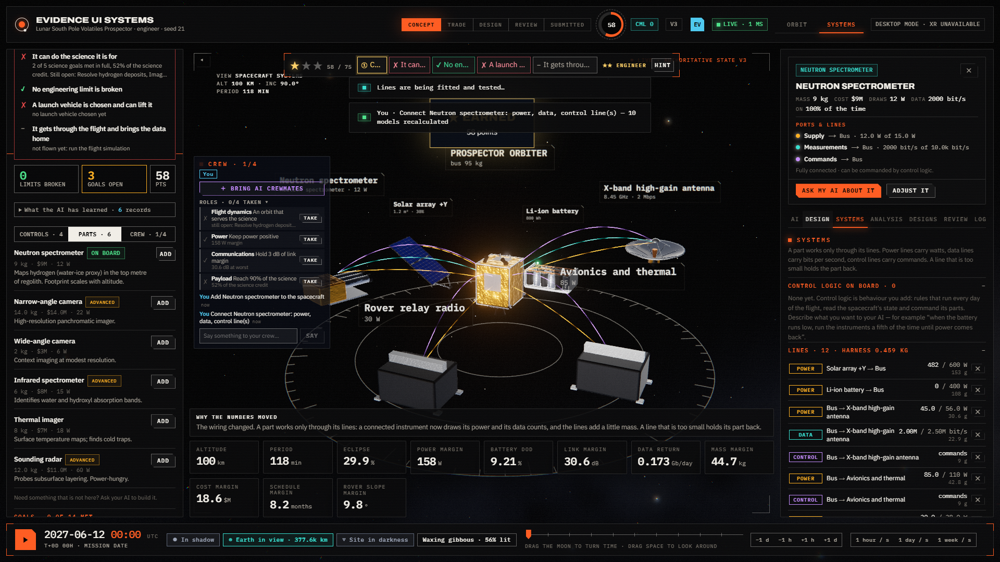

### 4.2 AI가 만드는 제어 로직

- 제어기 = 규칙 목록(`WHEN 조건 → 대상에 값 설정`), 기억 변수, 다운링크 우선순위. 버스 비행 컴퓨터나 온보드 컴퓨터에서 **비행 시뮬레이션의 매일** 실행된다.
- 읽을 수 있는 신호 15종(배터리 잔량, 전력 여유, 식 비율, 링크 여유, 저장 공간 등)과 명령 대상(장비·안테나·부하의 가동률)은 Systems 탭 하단에 표로 공개된다.
- 제어선이 없는 부품은 명령할 수 없다. 없는 신호를 읽거나 형식이 틀린 규칙은 설계에 들어가기 전에 거부된다.
- **사용**: My AI에 원하는 동작을 문장으로 요청 → AI가 규칙을 만들고 전후 비행 결과를 보고 → (필요 시 승인) → Systems 탭에서 규칙 확인·끄기·삭제 → Analysis에서 비행 → Systems 탭의 "What it did on the last flight".

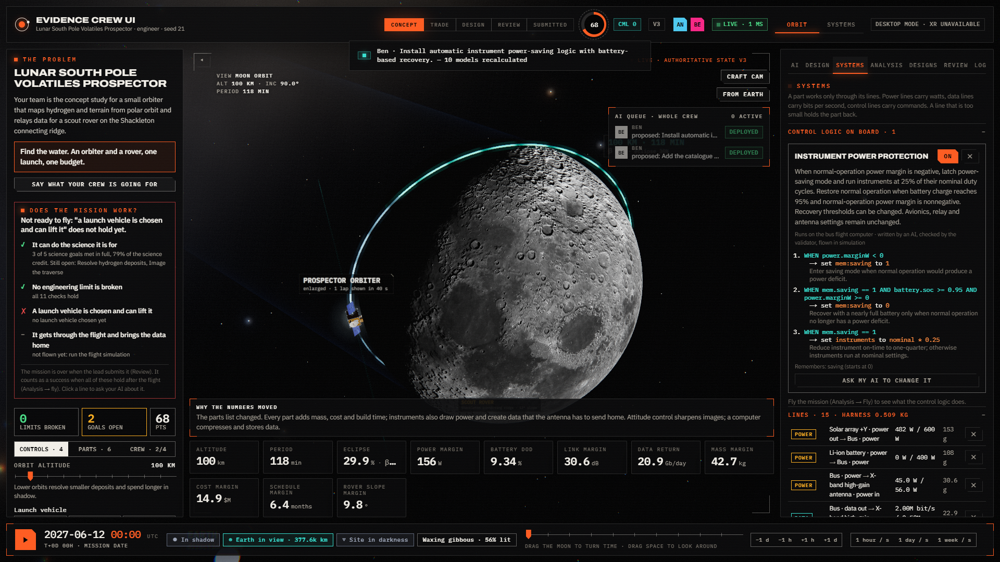

### 4.3 개인 AI

- 플레이어마다 자신의 대화 문맥(최근 6개 문답)이 따로 유지된다. "그거 해줘" 같은 후속 요청이 자기 대화에만 이어진다.
- AI는 매 요청마다 최신 임무 구성, 계산 결과(배선 분석 포함), 목표 달성 현황, 부품 목록을 읽는다.
- 질문만 하면 공유 세계는 바뀌지 않는다. 만들어 달라고 하면 시험 사본에서 만들고 검사한 뒤, 정책에 따라 바로 반영되거나 승인을 기다린다.
- 검증에서 거부되면 사유를 모델에 돌려보내 최대 2번 고쳐 본다.
- 대화는 기본 비공개. **Share with crew**로 공개·취소한다.
- 대화는 주제별 대화방으로 나뉜다: 임무 전체, 그리고 선택한 부품마다 하나. 대화는 아래로 쌓이고 입력창은 맨 아래에 있다.
- **MR에서**: 조작 패널의 빠른 명령이나 가상 키보드로 묻고, 답은 탁자 위 "내 AI" 패널에서 읽는다(앞 8줄. 나머지는 웹 패널).

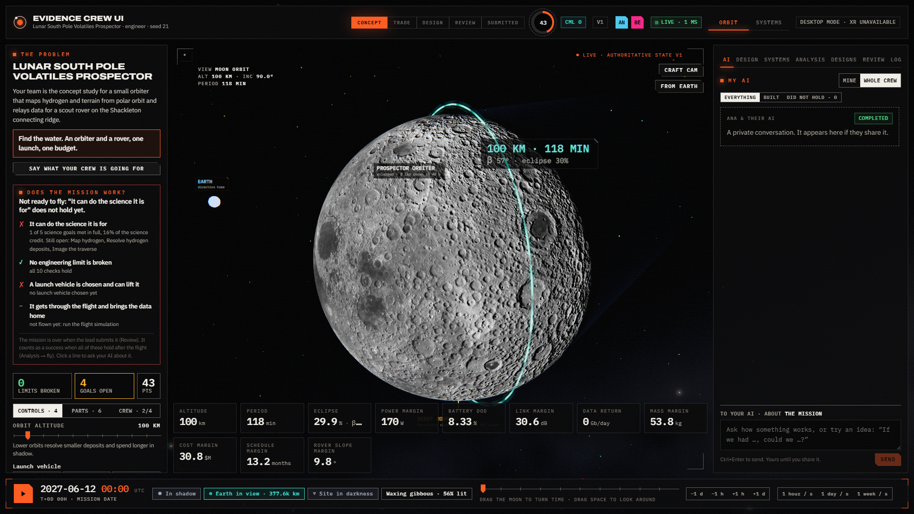

### 4.4 임무 판정이 먼저

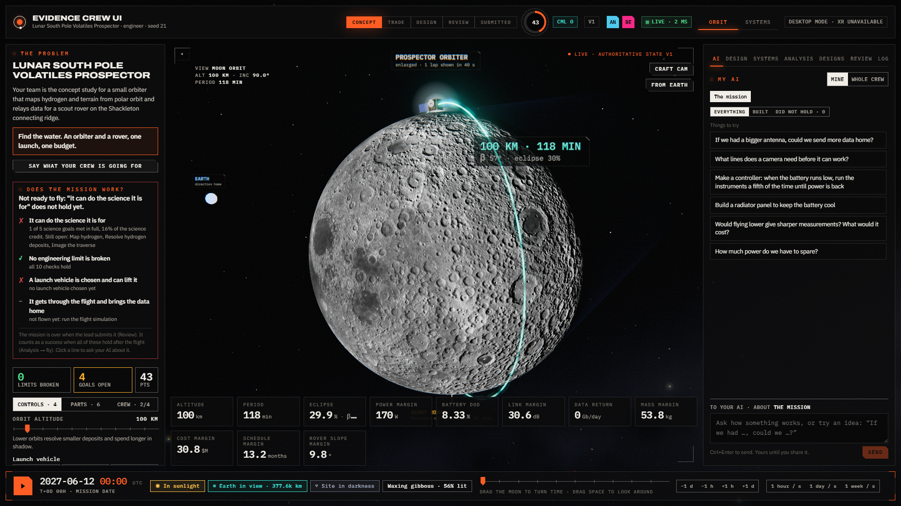

### 4.5 공유 시계, 설계 비교, 이력

- 시계 덱: 재생/정지, 1시간·1일·1주/초, ±1시간·±1일 단계 이동, 슬라이더. 누가 돌리든 전원이 같은 시각을 본다. 행성을 드래그해도 시간이 돈다.
- Designs 탭: 설계 저장, 공유, 나란히 비교. Log 탭: 버전 이력(누가 무엇을), 이전 버전으로 되돌리기(리드).

### 4.6 MR에서 같은 임무

- 주소 끝에 `&iwer=1`(에뮬레이터) 또는 헤드셋 브라우저에서 **Enter MR**. 탁자 크기의 임무가 눈앞에 놓이고, 세션이 시작될 때 낮 쪽이 플레이어를 향한다.
- 왼쪽 패널: 임무 판정, 열린 조건, 배선 상태, 제어 로직, 주요 수치. 오른쪽 패널: 화면 전환, 비행, 상황에 맞는 빠른 명령 4개(미연결 부품 Connect 등), 승인·거부, 키보드.
- 부품을 컨트롤러로 집으면 선택되고, 오른쪽 패널에 그 부품에 무엇이 빠졌는지 나온다. 슬라이더(고도·경사·임무일)와 시간 고리는 손으로 잡아 움직인다.
- 화면 구성은 웹과 다르지만 같은 임무 상태·같은 서버 판정을 쓴다. 검증 수준은 에뮬레이터다(14장).

## 5. 승인 없이 추가한 기능과 이유

전체 목록과 대안·영향·검증은 `docs/ADDED_DECISIONS.md`에 있다. 요약:

| 번호 | 추가한 것 | 이유 | 결과 |
|---|---|---|---|
| D-01 | 회선이 없으면 부품이 동작하지 않는 배선 모델 | 회선이 실제 흐름을 전달해야 함 | 단위 테스트 5건, UI 검증 통과 |
| D-02 | 미션은 배선된 상태로 시작, 새 부품은 미연결로 도착 | "시작 시 빌드 완료"와 "회선을 묻고 연결"을 동시에 | UI·플레이스루 통과 |
| D-03 | 정격이 모자란 선은 부품을 제한 | 수치만 올리는 슬라이더 게임 방지 | 단위 테스트 통과 |
| D-04 | 자체 파서 기반 규칙 언어(eval 없음) | 새 동작 실행 + 무제한 실행 금지 | 적대적 입력 12종 거부 |
| D-05 | 제어 로직을 제안 전에 실제 비행으로 전후 비교 | 말과 검증의 분리 | 실제 모델 실행 증거 |
| D-06 | 검증 거부 사유를 모델에 돌려 재시도 | 실패 원인 분석·재검증 | 테스트 통과 |
| D-07 | 개인 AI 대화 기본 비공개 | 개인 대화 무조건 공개 금지 | HTTP·WS·UI 검증 |
| D-08 | 플레이어별 대화 문맥 | 독립된 대화 문맥 | 프롬프트 내용 단언 |
| D-09 | 임무 성립 판정을 점수보다 먼저 | 달성 여부와 근거 우선 | UI 검증 |
| D-10 | 3D 선 = 실제 회선, 이유 없는 회전 제거 | 장식과 상태 구분 | Web·MR 선 개수 일치 |
| D-11 | 헤드셋 상태·빠른 명령이 설계 상태를 따름 | Web과 MR 같은 흐름 | 에뮬레이터 검증 |
| D-12 | 공유 시계 단계 실행 | 단계 실행 공유 | 구현(버튼 브라우저 확인은 3장 참조) |
| D-13 | 프로젝트 범위 Stop 훅 | 야간 연속 실행 | 15장 |
| D-14 | 아이디어 판정 분류(조건부 / 성립 안 함 / 모델 범위 밖)와 "Did not hold" 보관함 | 가설 상태 구분, 실패한 가설 보존 | 테스트·UI 검증 |
| D-15 | 개인 대화의 연구 기록도 본인만 열람 | 비공개 원칙이 다른 화면으로 새지 않게 | 테스트 통과 |
| D-16 | 분석 스크립트 생성의 검증·수정 반복 | 실패 원인 분석 후 재시도 | 테스트 통과 |
| D-17 | 키 없이도 "connect …" 문장으로 연결 | 인증 없이 가능한 작업 유지 | 테스트 통과 |
| D-18 | 3D에서 미연결·정격 부족 부품을 색과 문구로 표시 | 무엇이 잘못됐는지 바로 보이게 | 화면 캡처 |
| D-19 | 초기 문제 "축소된 태양전지판"(그 미션의 연중 발전량으로 크기를 정해 반드시 일부 기간 부족)과 내장 브리프, 로비에 항상 게시 | 제어 로직·배선 선택이 실제 해법이 되는 문제가 필요 | 6개 시드에서 하드웨어·제어 로직 두 해법 검증, 실제 모델 플레이 |
| D-20 | AI가 현재 설계의 전체 비행 결과(부족 기간·날짜·사건·장비별 데이터·제어 로그)를 읽음 | "언제 무슨 일이 생기나"를 추측이 아니라 시뮬레이션으로 답하게 | 실제 모델이 날짜로 답함(이전에는 97초 뒤 답변 불가) |
| D-21 | 각 AI가 자기 플레이어의 좌석(역할)과 다른 좌석 담당자를 앎 | 4명이 각자 맡은 부분을 자기 AI와 수행 | 프롬프트 내용 단언 테스트 |
| D-22 | 비행 결과에 장비별 데이터(회수/손실)와 제어 로그 표시, 임무 성공이 모든 미션에서 도달 가능함을 테스트로 고정 | 결과의 근거를 화면에, 이길 수 있는 게임 | UI 검증, 플레이 가능성 테스트 |
| D-23 | AI 대화를 주제별 대화방으로 분리(임무 전체 / 부품별), 대화는 아래로 쌓이고 입력창은 맨 아래 | 사용자 테스트 피드백: 배터리 질문과 분광계 질문이 한 방에 섞임, 대화가 위로 진행 | 브라우저 검증 10개 통과 |
| D-24 | AI가 스스로 미션을 계속 생성: 플레이되지 않은 미션이 4개 미만이면(또는 누가 미션을 가져가면) 새 미션 작성. 상한은 두지 않음(넣었다가 사용자 요청으로 제거; `BRIEF_DAILY_CAP`을 설정한 경우에만 적용). 끄려면 `BRIEF_AUTOGEN=off` | 사용자 요구: AI가 스스로 계속 미션을 창출 | 테스트 통과, 로비에 대기 수 표시 |
| D-25 | 화면 겹침 정리: 선택한 부품의 카드와 AI 대기열을 3D 화면 위가 아니라 오른쪽 패널 안에 둠(3D 화면 위에 뜨는 패널 없음). AI 답변 상자의 한쪽 색 띠 제거 | 사용자 테스트 피드백 | 전 부품 클릭 시 겹침 0쌍 |
| D-26 | 모델 비용 절감: 추론 강도 low, 버튼 조작은 모델 없이 답변, 요청 크기 축소, 용도별 토큰 집계 | 사용자 지적: 비용 과다 | 실측으로 확인 |
| D-27 | MR 화면을 실제 프레임으로 검증하고 결함 5건 수정(세션 멈춤, 빈 패널, 검은 달, 작은 라벨, 글자 겹침) | 사용자 지적: MR을 잊지 말 것 / 상태값만으로는 화면 결함을 못 잡음 | 에뮬레이터 프레임 캡처로 확인 |
| D-28 | MR에 "내 AI" 패널 추가: 헤드셋에서 한 질문과 답변을 탁자 위 넓은 패널에 줄바꿈해 표시(이전에는 조작 패널의 한두 줄에 잘려 보임) | MR에서도 자기 AI와 대화할 수 있어야 함(지시서: Web·MR은 하나의 제품) | 에뮬레이터에서 질문→답변 표시 확인 |
| D-29 | 창 크기별 레이아웃 검사와 작은 창용 배치(타일 축소, 안내 자동 사라짐, 시간 막대 한 줄) | 사용자 지적: UI가 겹침 / 1920×1080에서만 확인하고 있었음 | 네 크기에서 가림 비율 측정 |
| D-30 | 모델 없이 도는 UI 검사 3종(대화방, 2인 비공개 대화, 1인 전체 흐름)을 전체 검증에 포함 | 비용 문제 이후 실제 모델 UI 검사를 다시 돌리지 않게 되어, 사용자 지적 사항과 제출 흐름이 매번 확인되지 않았음 | 34개 검사 통과. AI의 답 내용은 이 검사들의 대상이 아님 |

## 6. 발견한 문제와 수정, 재검증

| 문제 | 원인 | 수정 | 재검증 |
|---|---|---|---|
| 배선 모델 도입 후 기존 테스트 12건 실패 | 테스트가 부품을 "추가만" 하고 연결하지 않음 | 테스트가 부품을 하네스와 함께 설치하도록 변경, 미연결이면 목표 0점임을 단언하는 검사 추가 | 단위 테스트 전부 통과 |
| 큐브샛 미션이 80점에 도달 불가 | 하네스 길이를 1.5 m로 고정해 4 kg급 위성에 과도한 질량 | 선 길이를 버스 크기에 비례(0.15–3 m) | 플레이 가능성 테스트 통과 |
| AI가 제어기 요청에 임계값을 되물음 | 프롬프트가 누락값을 질문하도록 유도 | 임무 수치에서 기본값을 정하고 가정으로 기록하도록 규칙 추가 | 실제 모델이 즉시 제작 |
| 식 파서가 정상 식을 "너무 깊다"로 거부 | 연산자 우선순위 단계를 중첩으로 계산 | 괄호·함수·단항만 중첩으로 계산 | 단위 테스트 통과 |
| 비행 로그가 "기억값 변경"까지 부품 명령처럼 표시 | 발화한 모든 규칙을 기록 | 부품에 명령한 규칙만, "평소값 → 명령값"으로 기록 | 플레이스루 로그 확인 |
| 브라우저 E2E 1건 실패 | "Systems" 버튼이 2개(뷰 전환, 탭)가 되어 선택자 모호 | 정확 일치 선택자 | 48/48 통과 |
| AI 큐가 화면 버튼과 겹침, 비공개 항목이 빈칸 | 위치·문구 | 위치 이동, "talking with their AI (private)" 표기 | 화면 캡처 확인 |
| 실제 모델이 쓴 분석 스크립트가 타입 검증에서 탈락(간헐) | 생성과 검증이 분리되어 재시도가 없었음 | 생성 단계에서 검증·샌드박스 실행 후 거부 사유를 돌려 최대 2회 수정 | 테스트 추가, 실제 모델 1건 통과 |
| 이름 없는 슬라이더, 이유 없이 비활성인 버튼 5종 | 접근성 레이블·title 누락 | 레이블과 비활성 사유 추가 | 컨트롤 점검 18개 화면 통과 |
| 비공개 대화의 문장이 연구 기록 목록(전 계정 열람)에 남음 | 요청 기록만 가리고 연구 메모리는 가리지 않았음 | 대화 유래 기록에 소유자 표시, 목록·검색·단건 조회·유사 사례 검색에서 본인만 | 테스트 추가·통과 |
| 부품 카드가 선택한 부품을 가림, AI 답변 하단 문구가 좁게 눌림 | 배치 | 카드를 오른쪽으로, 하단을 두 줄로 | 화면 캡처 확인 |
| "연중 언제 전력이 모자라?"에 AI가 97초 뒤 "알 수 없다"고 답함 | AI 문맥에 비행 시뮬레이션 결과가 없었음 | 현재 설계를 즉시 비행시켜 부족 기간·날짜 등을 AI 문맥에 포함 | 같은 질문에 10초 만에 날짜로 답 |
| 기본 미션에서 AI가 만든 제어 로직이 "작동 0일"로 끝남 | 기본 설계의 전력 여유가 커서 제어 로직이 필요 없었음 | 전력이 모자란 초기 문제(축소된 태양전지판) 추가 | 제어 로직 48일 작동, 부족일 48→0 |
| (사용자 테스트) AI 대화가 위로 쌓임 | 최신 요청을 목록 맨 위에 두고 갱신 때마다 재정렬 | 시간순 정렬, 새 메시지는 아래, 입력창 맨 아래, 자동 스크롤 | 브라우저 검증 |
| (사용자 테스트) 배터리에 한 질문과 분광계에 한 질문이 같은 대화방 | 대화에 주제 개념이 없었음 | 요청에 주제(부품 ID) 저장, 주제별 대화방·주제별 문맥, AI에게 "이 대화는 이 부품에 관한 것"이라고 알림 | 같은 문장을 두 부품 방에서 물어 각각 그 부품으로 답함 |
| (사용자 테스트) 시스템 뷰에서 클릭하면 UI가 겹침 | 부품 카드·AI 대기열·안내 띠가 같은 영역에 동시에 표시 | 처음에는 한 번에 하나만 표시·카드 위치 고정 → 이후 부품 카드와 AI 대기열을 오른쪽 패널 안으로 옮겨 3D 화면 위에 뜨는 패널을 없앰 | 전 부품 순차 선택 시 겹침 0 |
| (사용자 테스트) 한쪽에 색 띠가 있는 상자 | AI 답변 상자의 왼쪽 색 띠 | 띠 제거(판정은 칩으로만 표시) | 브라우저 검증 |
| (사용자 테스트) AI가 스스로 미션을 계속 만드는가 | 하루 6개까지만 채우고 3시간마다 확인 | 미플레이 미션 수 기준으로 20분마다·미션이 선택될 때마다 자동 생성 | 테스트 통과 |
| "전력이 모자란 미션"이 뽑힌 궤도·날짜에 따라 전혀 모자라지 않음(전체 재검증에서 발견) | 전지판을 고정 비율(절반)로 줄였음 | 그 미션의 연중 발전량을 계산해 최악 계절에 10% 부족하도록 크기 결정 | 6개 시드 테스트, 새 서버에서 UI 검증 |
| 새로 설치한 서버에서 상시 미션이 로비에 늦게 올라옴(전체 재검증에서 발견) | AI가 첫 미션을 다 쓴 뒤에야 게시 | 목록을 읽을 때 즉시 게시 | 새 서버에서 통과 |
| **OpenAI 비용이 과도하게 발생(사용자 지적)** | ① 추론 강도를 지정하지 않아 요청마다 숨은 추론 토큰이 기본 강도로 청구됨(요청당 8–25초, 최대 97초) ② 검증용 서버가 뜰 때마다 AI가 미션 6개를 작성(약 50회) ③ 버튼 조작(부품 추가·연결)에도 답변 문장을 모델에 요청 ④ 요청마다 15자리 숫자와 중복 배선 정보 전송 | ① 추론 강도 low로 요청(모델이 거부하면 자동으로 뺌) ② 검증용 서버는 키 없이 기동, 실제 모델 검증은 `--live`일 때만 ③ 버튼 조작의 답변은 계산 결과로 작성 ④ 숫자 5자리·중복 제거 ⑤ 토큰 사용량을 용도별로 집계해 `/api/llm-usage`와 서버 로그에 표시 | 수정 후 실측: 질문 1건 3.8초·추론 0토큰, 제어 로직 생성 추론 130토큰. 요청 1건 입력 약 9천 토큰. 모델 없는 플레이스루 30–44초 → 1초 |
| **노트북 크기 창에서 UI가 3D 화면을 덮음** (1366×768로 캡처해 발견) | 수치 타일 11개가 세 줄로 쌓이고 "왜 숫자가 움직였나" 안내가 계속 떠 있어, 가운데 3D 화면이 거의 보이지 않음. 시간 막대는 두 줄로 꺾임. 타일 사이 빈 곳에서도 달을 끌 수 없었음 | 작은 창에서는 타일을 작게 한두 줄로, 안내는 12초 뒤 스스로 사라짐, 시간 막대는 한 줄(좁으면 달 위상 칩을 숨김), 타일 사이는 끌기를 통과시킴, 선택한 부품 카드는 탭 아래 공간을 남기고 내용은 카드 안에서 스크롤, 카드의 버튼 줄(Connect it 등)은 카드 아래에 고정되어 항상 보임 | `ui-layout.mjs` 24 / 24(부품을 선택한 채 AI 탭을 열어도 입력창 전체가 보이는지, 부품 카드의 버튼이 카드 안에서 스크롤하지 않아도 보이는지 포함): 1280×720·1366×768·1536×864·1920×1080 네 크기에서 안내가 떠 있을 때 화면 가림 15–27 %, 사라진 뒤 7–17 %, 시간 막대 한 줄, 창 밖으로 넘침 0 (크기별 수치는 `reports/evidence/ui-layout.md`) |
| 날짜가 브라우저 언어(한국어) 형식으로 표시되어 세 줄로 꺾임, 연구 기록의 Mission 칸에 "v"만 표시 | 날짜를 브라우저 기본 형식으로 출력. 미션에 속하지 않은 기록에도 "v"를 붙임 | 날짜·시각을 한 가지 영어 형식으로 통일("15 Nov 2026, 05:53"), 미션이 없으면 "–" | 화면 캡처 `reports/evidence/ui/65-research.png` |
| 모델 없이 만든 답의 표기가 어색함("Max data rate bps at3 db margin") | 계산 결과의 필드 이름을 낱말로 풀 때 글자와 숫자 사이를 띄우지 않고 단위 표기를 그대로 둠 | "Max data rate bit/s at 3 dB margin", "Eb/N0"로 풀어 씀 | 단위 테스트 2건 추가 |
| **MR 세션이 멈춤** (헤드셋 프레임 수를 재다가 발견) | 세션 중 부품이 추가된 뒤 컨트롤러 광선이 부품의 이름표(스프라이트)에 닿으면 three.js가 프레임 루프 안에서 예외를 던지고, 그 뒤로 헤드셋 화면이 더 이상 그려지지 않음(2초간 0프레임). 상태값은 계속 맞게 바뀌므로 기존 MR 검증은 통과하고 있었음 | 이름표와 장식용 스프라이트는 카메라 없는 광선을 그냥 통과시킴 | 부품 추가 뒤 1.5초에 90프레임, 시스템 화면 2초에 121프레임, 광선을 작업공간 전체에 쓸어도 프레임 유지, 페이지 오류 0 |
| **MR 화면 결함 4건** (헤드셋 프레임을 처음 캡처해 발견) | ① 혼자 접속해 아무것도 바꾸지 않은 플레이어는 상태 패널이 비고 빠른 명령 버튼 4개가 "…"로 남음 — 패널 내용을 채우는 코드가 3D 작업공간이 만들어지기 전에 한 번만 실행됨 ② 달이 새까만 원으로 보임 — 세션 시작 위치에서 밤 쪽을 보게 됨 ③ 라벨이 탁자 크기로 줄어 읽을 수 없음 ④ 긴 값이 항목 이름 위로 겹치고, 안내 문장은 뒷부분만 보임. 버튼에 손을 댔다 떼면 라벨이 처음 글자로 되돌아가는 문제도 있었음 | ① 작업공간 생성·세션 시작 때 패널 다시 채움 ② 세션 시작 때 탁자를 한 번 돌려 낮 쪽이 플레이어를 향하게 하고, 탁자 모드에서는 밤 쪽 바닥 밝기를 올림 ③ 탁자 모드에서 라벨 확대(궤도 화면 2.2배, 부품이 촘촘한 시스템 화면 1.6배)하고, 이름표가 머리에서 본 방향 기준으로 서로 비켜 서게 함 ④ 값은 줄여 쓰고 넘치면 말줄임, 안내 문장은 앞에서부터 줄바꿈. 버튼은 자기 글자를 기억 | `xr-frame.mjs` 16 / 16 (가상 키보드로 친 문장이 내 AI에 전달되는지, 헤드셋에서 부품을 집으면 그 부품에 무엇이 빠졌는지 패널에 나오고 Connect로 선 3개가 놓이는지, 질문의 답이 AI 패널에 표시되는지 포함. AR·VR 각각: 세션 시작, 패널·버튼 채워짐, 2초에 120프레임, 프레임에 장면 있음 / VR: 부품 추가 뒤와 시스템 화면에서도 프레임 유지, 양손 컨트롤러 광선을 두 화면 전체에 66점씩 쓸어도 멈추지 않음). 에뮬레이터 수준 |
| 검증 실행이 브라우저 단계에서 멈춤 | 사용자의 Edge가 열려 있을 때 헤드리스 Edge 종료가 끝나지 않음 | 브라우저 종료에 8초 제한, 스크립트 명시적 종료 | 전체 검증 6분에 완료 |
| 3D 화면 위에 패널이 떠서 부품을 가림(부품 카드, AI 대기열), 3D 라벨끼리 겹침, 버전 목록의 Restore 버튼 잘림 | 무대 위 절대 배치, 라벨 간격 미처리 | 부품 카드와 AI 대기열을 오른쪽 패널 안으로 이동(3D 위에는 안내 띠와 지표만), 라벨은 화면상에서 겹치면 자동으로 띄움, 버튼 영역 고정 | 화면 캡처 확인, 전 부품 선택 시 겹침 0 |
| AI가 쓴 미션이 한 종류로 쏠림(최근 6개 모두 큐브샛·지상국 약화) | 생성 지시에 다양성 조건이 없었음 | 최근 사용한 미션 종류·초기 장애를 알려 주고 덜 쓴 것을 고르게 함 | 다음 자동 생성부터 적용(추가 모델 호출로 검증하지는 않음) |
| 증거 스크립트가 로그인 제한(429)에 걸림 | 짧은 시간에 여러 계정 시도 — 보안 기능이 정상 동작 | 제한은 그대로 두고, 스크립트가 가입 우선으로 시도·서버 재시작 후 실행 | 재실행 통과 |

## 7. Web · MR · 4인 협업 · AI 생성 · 런타임 실행 · 시뮬레이션의 연결 상태

| 연결 | 상태 | 근거 |
|---|---|---|
| AI → 공유 세계 | 연결됨 | AI가 만든 부품·선·제어기가 실제 ID로 미션 버전에 들어가고 모든 클라이언트에 전파 |
| 제어 로직 → 시뮬레이션 | 연결됨 | 실제 모델이 만든 제어기로 전력 부족일 155→0, 장비 강제 정지 127→0 |
| 회선 → 예산 계산 | 연결됨 | 미연결 장비는 부하·데이터 0, 연결 후 부하 113.5→125.5 W |
| Web ↔ Web (4인) | 연결됨 | 4 클라이언트 상태 해시 동일, 지연 중앙값 약 4 ms(로컬 루프백) |
| Web ↔ MR | 연결됨(에뮬레이터) | IWER 에뮬레이터에서 양방향 13개 검사 통과. 헤드셋이 그리는 프레임을 직접 읽는 검사 16개 통과(세션 멈춤 등 결함 5건을 이 검사로 찾아 고침) |
| MR의 개인 AI | 연결됨(에뮬레이터) | 헤드셋의 빠른 명령과 가상 키보드로 한 질문의 답이 탁자 위 "내 AI" 패널에 표시(둘 다 검사). 실제 모델로는 미확인(모델 없는 서버에서 확인) |
| MR 실기기 | **미검증** | 14장 |
| 개인 시점 vs 공유 상태 | 분리됨 | 한 사람의 카메라 이동이 다른 사람과 미션 버전에 영향 없음 |

## 8. 화면 캡처와 재현 가능한 플레이 절차

**그림의 시점에 대해**: 이 문서의 그림 중 실제 언어 모델로 실행하며 찍은 것(`10`–`14`, `30`–`36`번)은 01:00경의 화면이다. 그 뒤에 한 화면 정리(수치 타일의 잘린 글자, 배선 목록, 부품 카드를 오른쪽 패널 안으로, 작은 창 배치)는 반영되어 있지 않다. 최종 화면은 모델 없이 다시 찍은 `01`–`05`, `20`, `22`, `40`–`41`, `75`번 그림이다. 아래는 최종 화면(1920×1080, 부품 선택 상태)이다.

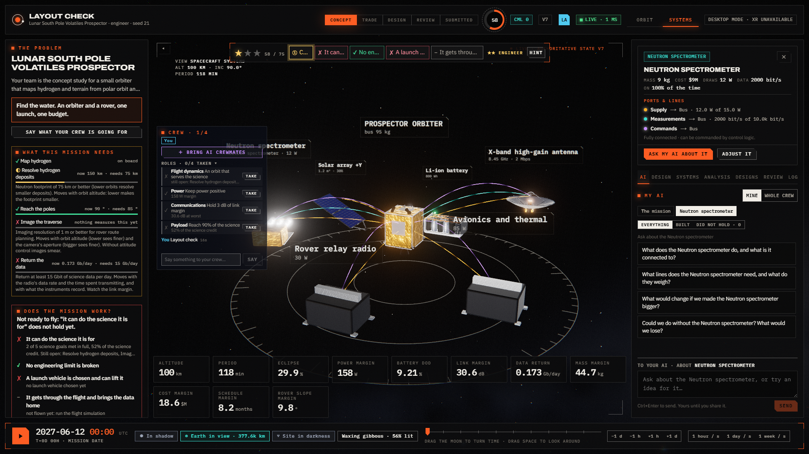

### 재현 절차 (약 5분)

1. `npm install` → `npm run install:web` → `npm run build:web` → `npm run dev` → 브라우저에서 `http://127.0.0.1:8787`
2. 계정 생성 → Lobby에서 미션 선택(예: Lunar South Pole Volatiles Prospector) → 생성.
3. 왼쪽 **Parts**에서 Neutron spectrometer **Add** → 부품이 미연결로 올라오고 "Does the mission work?"와 배선 경고가 바뀐다.
4. 상단 **Systems** 뷰에서 부품 클릭 → 오른쪽 패널 위쪽에 뜨는 부품 카드의 **Connect it** → 선 3개가 그려지고 목표가 켜진다.
5. 오른쪽 **AI** 탭: "Make a controller: when power runs short, run the instruments a quarter of the time until the battery is nearly full." → 답변에 전후 비행 결과 → **Systems** 탭에서 규칙 확인.
6. 왼쪽 **Controls**에서 발사체 선택 → **Analysis** 탭에서 비행 → 결과와 제어 로그 확인 → **Review**에서 제출.
7. 다른 브라우저(또는 시크릿 창)로 두 번째 계정을 만들어 같은 미션에 참가하면 모든 변경이 실시간으로 보인다.
8. MR(에뮬레이터): 미션 주소 끝에 `&iwer=1`을 붙여 열고 상단의 **Enter MR** → 탁자 위의 같은 임무. 부품을 집으면 오른쪽 패널에 상태가 나오고, 빠른 명령 **Connect …**로 연결한다. 웹 쪽 화면에도 그대로 반영된다.

이 절차는 고정 대본이 아니다. 다른 미션·다른 부품·다른 문장으로도 같은 엔진이 계산한다(큐브샛·화성 플레이스루 증거 참조).

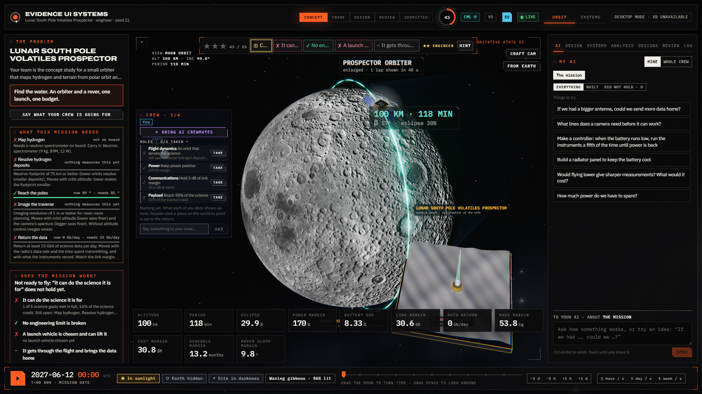

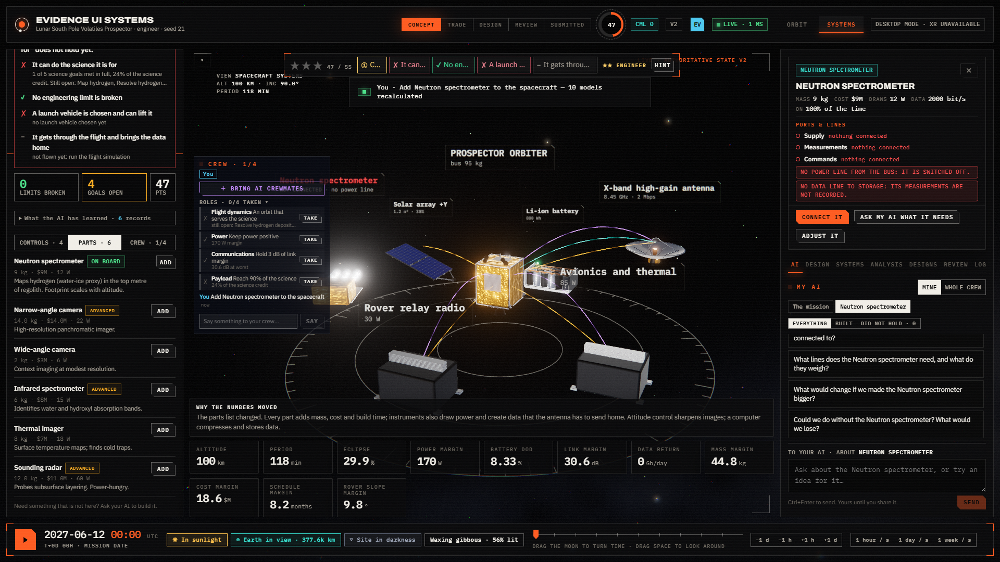

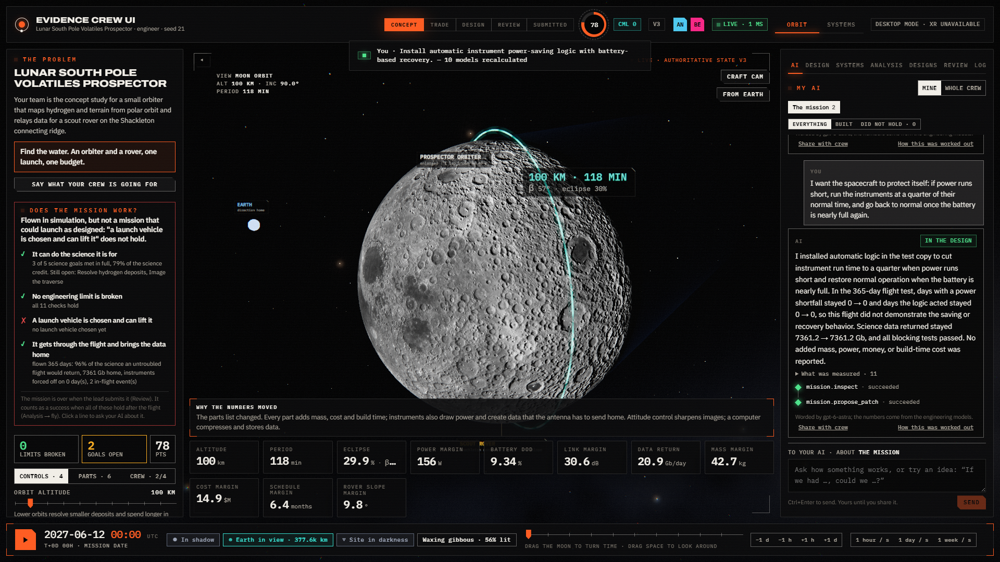

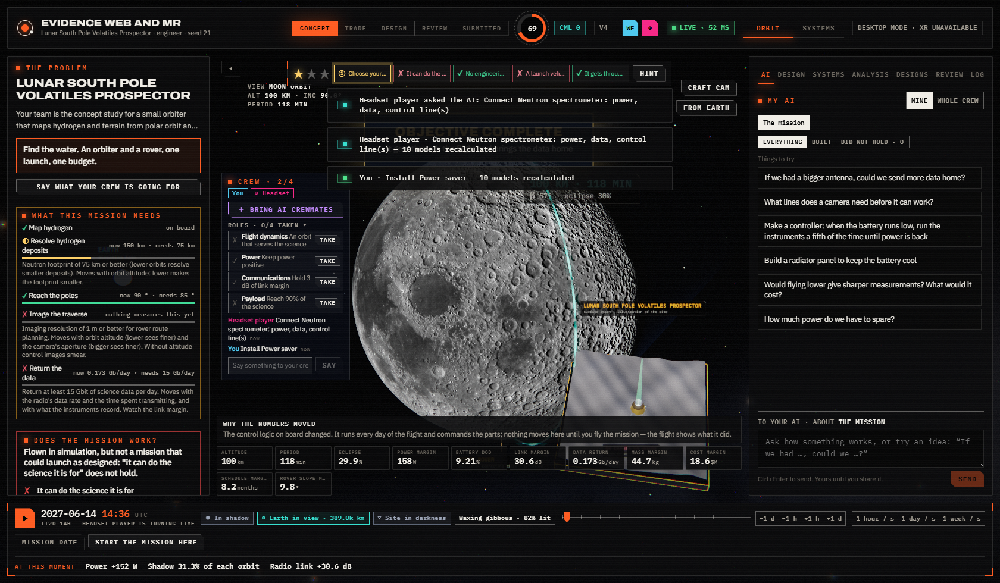

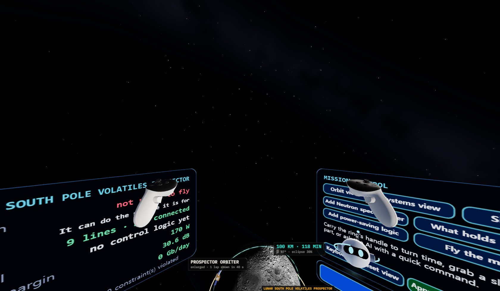

MR 몰입 화면은 페이지 캡처에 담기지 않으므로(XR 레이어로 그려짐), 렌더러가 세션용으로 그린 프레임을 직접 읽어 저장한다(`reports/tools/xr-frame.mjs`, 결과 `reports/evidence/xr-frame.md`). 위 그림이 그 프레임이다. 흰 컨트롤러 모형은 에뮬레이터가 그리는 것이다. **이 캡처를 새벽에 처음 떠 보고서야 MR의 결함 다섯 가지를 발견해 고쳤다**(6장). 그중 하나는 화면이 통째로 멈추는 문제였다.

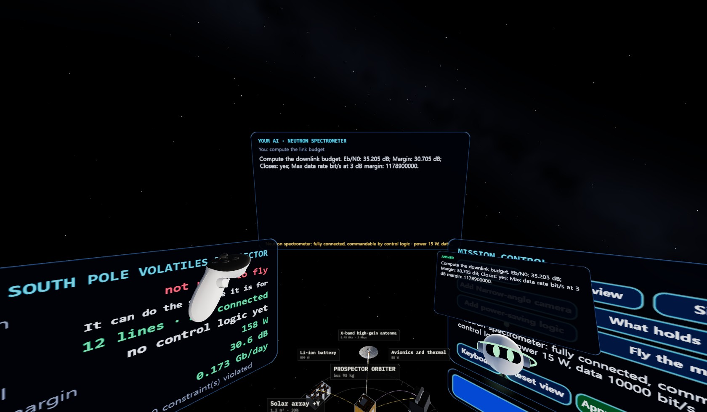

위 그림은 헤드셋 안에서만 한 일의 결과다: 웹에서 추가된 미연결 분광계를 컨트롤러로 집고(오른쪽 패널에 무엇이 빠졌는지 표시) → Connect로 선 3개를 놓고 → 가상 키보드로 "compute the link budget"을 쳐서 보냄 → 답이 "내 AI" 패널에 표시. 이 검증용 서버는 **언어 모델 없이** 떠 있으므로 답은 내장 분석기가 계산 결과로 쓴 문장이다. 실제 모델이 연결된 서버에서는 같은 자리에 모델의 답이 나온다(같은 코드 경로이지만 MR에서 실제 모델로는 돌려 보지 않았다).
 그 전까지의 MR 검증은 상태값(패널의 줄, 선 개수)만 읽었기 때문에 화면이 실제로 어떻게 보이는지는 확인하지 못하고 있었다.

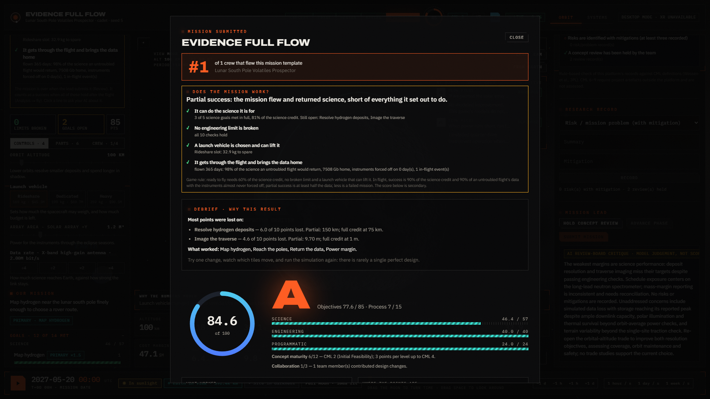

## 9. 테스트별 명령, 환경, 결과 (실제/모의 구분)

### 9.1 최종 코드에 대한 전체 재실행

코드가 바뀐 뒤에는 앞선 검증을 그대로 믿지 않고, `node reports/tools/run-all-evidence.mjs`로 **검증을 최종 코드에서 다시 실행**했다. 브라우저·API 스크립트는 각각 빈 데이터 폴더로 새로 띄운 서버에서 돌았다. 아래 표는 **언어 모델을 한 번도 호출하지 않는** 실행이다(검증용 서버는 API 키 없이 뜬다). 실제 모델을 쓰는 검증은 비용 때문에 `--live`를 붙일 때만 돈다.

{{VERIFICATION_SUMMARY}}

| 검증 | 명령 |
|---|---|
| 단위·통합 테스트 | `npm test` |
| 브라우저 E2E | `npm run e2e` |
| 배선 UI 흐름 | `node reports/tools/ui-systems.mjs` |
| 컨트롤 점검 | `node reports/tools/ui-buttons.mjs` |
| 전력이 모자란 미션의 비행(제어 로직 전후) | `node reports/tools/ui-flight.mjs` |
| 장시간 세션(4명, 600회 편집) | `node reports/tools/soak.mjs 600` |
| 4 클라이언트 | `node reports/tools/fourclients.mjs` |
| Web ↔ MR | `node reports/tools/xr-loop.mjs` |
| MR 헤드셋 프레임 | `node reports/tools/xr-frame.mjs` |
| 창 크기별 레이아웃 | `node reports/tools/ui-layout.mjs` |
| 플레이스루 | `node reports/tools/play-mission.mjs <leo-cubesat / mars-weather-relay / lunar-volatiles>` |
| 대화방·겹침 (실제 모델) | `node reports/tools/ui-chat.mjs` |
| 대화방·겹침 (모델 없이, 전체 검증에 포함) | `node reports/tools/ui-chat.mjs --no-model` |
| 2인 비공개 대화·공유·개인 시점 (모델 없이, 전체 검증에 포함) | `node reports/tools/ui-private.mjs` |
| 1인 전체 흐름: 첫 화면 → 정의 → 부품·연결 → 발사체 → 비행 → 설계 비교 → 검토·제출 → 디브리프 (모델 없이, 전체 검증에 포함) | `node reports/tools/ui-fullflow.mjs --no-model` |
| 2인 UI + 개인 AI | `node reports/tools/ui-crew.mjs` |
| 1인 전체 흐름 (실제 모델) | `node reports/tools/ui-fullflow.mjs` |
| 깨끗한 환경 구동 | `node reports/tools/clean-run.mjs` (4 / 4, `reports/evidence/clean-run.md`) |

**실제 모델을 쓰는 UI 검증의 마지막 실행 결과** (그 뒤로는 비용 문제로 전체를 다시 돌리지 않았다): 2인 UI + 개인 AI 12 / 12, 1인 전체 흐름 16 / 16 (01:01 실행), 대화방·겹침 10 / 10 (01:32 실행). 그 이후의 변경(추론 강도 낮춤, 요청 크기 축소, 버튼 조작 답변을 모델 없이 작성, 전력 부족 미션의 전지판 크기 결정 방식)은 실제 모델 요청 4건으로만 확인했다: 질문 1건, 부품 추가·연결 1건, 제어 로직 생성 1건(`reports/evidence/cost-probe.md`, `cost-probe-controller.md`), 그리고 04:38에 AI의 미션 생성 1건(`reports/evidence/live-brief.md` — 최근에 낸 미션과 겹치지 않게 쓰도록 바꾼 프롬프트로 새 미션이 만들어지고, 그 미션이 배선·계산된 상태로 열리는지) — 모두 정상. **새벽에 고친 MR 화면과 "내 AI" 패널은 실제 모델로는 돌려 보지 않았다**(모델 없는 서버에서만 확인).

### 9.2 실제 언어 모델과의 대화 기록

| 내용 | 결과 | 증거 |
|---|---|---|
| 세계를 읽고 원인 설명 | 현재 수치로 설명, 세계 변경 없음 | `reports/evidence/e04-e06-control.md` |
| 장비·회선·제어 로직 제작 | 부품 2 + 선 6 + 제어기, 전력 부족일 155→0 | `reports/evidence/e05-e06-build-control.md` |
| 틀린 가설·모델 범위 밖 가설 (화성 미션) | 거부 + 근거 + 대안, 모델 한계 명시 | `reports/evidence/e07-e08-e17-mars.md` |
| 회선에 대한 네 가지 표현 | 연결 없이 추가 / 필요한 선 설명 / 정격을 지정한 선 2개 추가 / 제어선 제거 | `reports/evidence/wiring-phrasings.md` |
| 분석 스크립트 생성 | 생성·검증·부착 성공 | `reports/evidence/script-generation.md` |
| "전력이 모자란 미션"(축소된 태양전지판) 플레이 | 장비 2개 추가 후 전력 부족 48일·장비 강제 정지 27일 → "언제 모자라?"에 날짜로 답(2028년 5월 중순~6월 하순) → 제어 로직이 48일 작동해 부족일 48→0, 정지 27→0, 회수 데이터 17326.7→16862.2 Gb → 전지판을 키우는 방법과의 차이 설명(제작 없음) | `reports/evidence/lean-array-play.md` |

### 9.3 측정값

- 동기화 지연(같은 PC 루프백, n=72): 편집 전송 → 다른 클라이언트 수신 중앙값 약 4 ms, p95 6–7 ms, 최대 8 ms 안팎(실행마다 조금씩 다르다. 마지막 실행 값은 `reports/evidence/four-clients.md`). 엔진 재계산 시간 포함. 실제 네트워크에서는 왕복 시간이 더해진다.
- 장시간 세션(`node reports/tools/soak.mjs 600`): 4 클라이언트가 번갈아 600회 편집(궤도·부품 크기·선 추가/제거·제어 로직 추가/제거)과 비행 6회 — 600회 모두 적용, 지연 중앙값이 처음 100회와 마지막 100회에서 모두 3–4 ms로 느려지지 않음(마지막 실행: 3.6 ms → 3.0 ms), 네 클라이언트의 최종 버전(v602)·구성·판정·점수 일치. 마지막에 2000회 편집·비행 20회로도 한 번 돌렸다(07:30): 2000회 모두 적용, 지연 중앙값 3.8 ms → 2.9 ms, 네 클라이언트 최종 버전(v2002)·구성·판정·점수 일치(`reports/evidence/soak-2000.md`). `reports/evidence/soak.md`
- 실제 모델이 쓴 미션 브리프(`node reports/tools/live-brief.mjs`): 킷의 부품이 모두 카탈로그에 존재, 만들어진 미션이 처음부터 배선·계산된 상태. `reports/evidence/live-brief.md`
- 플레이스루 스크립트(`play-mission.mjs`)는 풀이기가 아니라 **정해진 최소 수순**(첫 관측 장비·자세 제어·컴퓨터 추가, 연결, 제어 로직 설치, 가장 싼 발사체, 비행, 제출)만 둔다. 확인하는 것은 서로 다른 미션이 같은 엔진으로 제출·평가까지 간다는 점이다. 그 수순으로 얻는 판정은 표준 시드에서 큐브샛 "비행 준비 안 됨", 화성 "부분 성공", 달 "비행 준비 안 됨"이고, 마지막에 시드 3개씩 더 돌린 9회에서는 성공 4, 부분 성공 1, 비행 준비 안 됨 4였다(달 시드 11: 과학 점수 58 % — 카메라·낮은 궤도·빠른 링크가 필요한 목표가 남음. `reports/evidence/play-extra-seeds.md`). **임무 성공에 도달할 수 있다는 것**은 이 스크립트가 아니라 `tests/playability.test.ts`가 고정한다: 모든 미션·난이도(시드 2개씩)에서 한도를 지키고 비행 사건을 견디며 80점 이상, 판정 "성공" 또는 "부분 성공"으로 끝낼 수 있고, 미션마다 "성공" 판정에 이르는 조합이 적어도 하나 있다(모든 난이도에서 성공 판정이 난다는 뜻은 아니다).
- 임무 시뮬레이션 1회(365–687일): 60–120 ms.
- 실제 모델 요청 1건: 비용 수정 전 7–25초(최대 97초). 추론 강도를 낮춘 뒤 실측은 질문 1건 3.8초였다(실측 3건뿐이므로 범위로 말할 수는 없다).

실기기 MR 테스트와 실제 GMAT 실행은 수행하지 않았다(14장).

## 10. NASA 자료, 계산 모델, 가정, 불확실성, 단순화

**사용한 공개 자료** (모두 키 불필요): JPL Horizons(천체력), NASA GIBS(지구 영상), Moon/Mars Trek(달·화성 영상 타일), PDS Geosciences(LOLA·MOLA 지형). `Data/` 폴더의 NASA 문서 3종(과학 임무 설계 가이드, CML, CubeSat 101)은 지식 베이스로 색인되어 AI 답변의 참고 자료로 쓰인다.

**계산 모델과 단순화**:

| 영역 | 모델 | 생략·가정 |
|---|---|---|
| 궤도 | 2체 문제, 궤도 요소 고정 | J2 세차·항력·3체 섭동 없음(J2 전파는 별도 오버레이로만) |
| 식(eclipse) | 원통형 본그림자, 베타각 | 반그림자 없음, 승교점 고정 |
| 전력 | 궤도 평균 발전·부하, 배터리 방전 깊이 | 변환 손실·열 영향 없음, 부하는 가동률 평균 |
| 통신 | 링크 예산(자유공간 손실, 안테나 이득, 지향 손실) | 대기·강우·지상국 일정 없음 |
| 데이터 | 생성량 대 다운링크 용량, 저장 공간, 압축비 | 프로토콜 오버헤드 없음 |
| 배선 | 버스 중심 별형 분배, 선 정격 제한, 하네스 질량 | 전압·선로 손실 없음, 정격 부족은 "그 비율만큼 가동"으로 처리, 하네스 질량은 경험식 |
| 제어 로직 | 하루 1회 실행, 그날의 상태로 판단 | 실시간 비행 소프트웨어가 아님, 안전 모드 중에는 실행 안 함 |
| 비행 | 하루 단위, 그날의 태양 방향·거리·지구 거리 | 사건의 종류는 실제 이상 유형이지만 날짜·크기는 고장 통계가 아님(시드로 결정) |
| 비용·일정·발사체 | **게임 가정** | NASA 비용 추정이 아님. 부품 가격은 카탈로그 값, 발사체는 일반 등급 |
| 임무 판정 규칙 | **게임 규칙** | 과학 점수 60%·90%, 회수율 50%·90% 기준은 이 게임이 정한 값 |

시뮬레이션에서 유리했다는 결과는 현실에서 실증됐다는 뜻이 아니다. UI의 각 계산 결과에는 가정이 붙어 있고, AI가 말로 쓴 부분은 "모델이 쓴 문장, 숫자는 엔진"이라고 표시된다.

## 11. 최종 빌드와 실행·접속·검증 방법

```
npm install            # 서버 의존성
npm run install:web    # 웹 클라이언트 의존성
npm run build:web      # apps/web/out 정적 빌드 (서버가 직접 제공)
npm run dev            # http://127.0.0.1:8787  (API /api, WebSocket /ws)
npm test               # 단위·통합 테스트
npm run e2e            # 브라우저 E2E (새 임시 서버를 띄워 실행)
```

- **같은 PC**: `http://127.0.0.1:8787`
- **다른 PC·헤드셋(같은 네트워크)**: `.env`에 `HOST=0.0.0.0`과 `TLS_CERT_FILE`, `TLS_KEY_FILE`을 설정 후 `https://<PC의 IP>:8787`. WebXR은 localhost가 아니면 HTTPS가 필요하다.
- **MR 에뮬레이터**: 주소 끝에 `&iwer=1`을 붙이면 소프트웨어 Quest 3이 설치되어 헤드셋 없이 몰입 세션을 확인할 수 있다.

## 12. 계정 · API · 장비 요청 목록과 설정 방법

실제 코드가 사용하는 서비스만 조사했다. 비밀값은 프로젝트 루트의 `.env`(git 제외)에 직접 입력한다. **키를 채팅이나 저장소에 붙이지 않는다.**

| 서비스 | 사용 기능 | 필수/선택 | 현재 설정 | 환경변수 | 공개/비밀 | 입력 위치 | 필요한 권한 | 과금·제한 | 없을 때 막히는 기능 | 설정 후 검증 |
|---|---|---|---|---|---|---|---|---|---|---|
| OpenAI API | 개인 AI(질문·가설·제작·제어 로직), 미션 브리프, 텍스트→3D | 선택(핵심 경험에는 사실상 필요) | **설정됨** | `OPENAI_API_KEY`, `OPENAI_MODEL`, `LLM_PROVIDER` | 비밀(키) | `.env` | 채팅 모델 호출 | 요청당 과금, 계정 한도 | 자유 문장 AI, 제어 로직 생성(규칙 기반 분석기로 축소) | `node reports/tools/live-ai.mjs check -- "What limits us?"` |
| Anthropic API | 위와 같음(대체 제공자) | 선택 | 미설정 | `ANTHROPIC_API_KEY`, `MISSION_AI_MODEL` | 비밀 | `.env` | 메시지 API | 요청당 과금 | 없음(OpenAI가 있으면) | 위와 같음 |
| JPL Horizons | 정밀 천체력 조회 | 선택 | 키 불필요 | — | 공개 | — | — | 무료 | 정밀 천체력 요청(내장 근사식은 동작) | 서버 `/api/capabilities` |
| NASA GIBS / Moon·Mars Trek / PDS | 행성 영상·지형 | 선택 | 키 불필요 | `MISSION_CACHE_DIR`(캐시 위치) | 공개 | — | — | 무료 | 실사 텍스처(절차 생성 대체) | E2E "planet is textured from NASA imagery" |
| TLS 인증서 | 헤드셋·다른 PC에서 접속 | MR 실기기에 필수 | 미설정 | `TLS_CERT_FILE`, `TLS_KEY_FILE`, `HOST` | 키 파일은 비밀 | `.env` + 파일 | — | 무료(자체 서명 가능) | 헤드셋 WebXR | 헤드셋 브라우저에서 `https://<IP>:8787` |
| MR 헤드셋 (Meta Quest 3 등) | 실기기 MR 검증 | 실기기 검증에 필수 | **연결·검증 안 됨** | — | — | — | 같은 네트워크 | — | 실기기 검증 | 14장 체크리스트 |
| GMAT | 외부 궤적 실행 | 선택 | 미설치 | `GMAT_BIN` | 공개 | `.env` | 로컬 실행 | 무료 | `gmat.run`(리포트 파일 가져오기는 동작) | `/api/capabilities`에서 gmat.run 상태 |
| pdftotext | `Data/` PDF 색인 | 선택 | 설정됨 | `PDFTOTEXT_BIN` | 공개 | `.env` | 로컬 실행 | 무료 | PDF 지식 베이스 | 서버 시작 로그 "Knowledge base: N document(s)" |
| 데이터 저장 | 계정·세션·버전·감사 로그 | 내장(파일) | 동작 | `MISSION_DATA_DIR` | — | — | 디스크 쓰기 | — | — | 재시작 복원 테스트 |
| 배포 환경 | 공개 호스팅 | 선택 | 없음(로컬 실행) | `HOST`, `PORT`, `ALLOWED_ORIGINS` | 공개 | `.env` | — | 호스팅 비용 | 인터넷 공개 접속 | — |

개발에 쓴 Claude Code의 인증과 게임 런타임의 AI 키는 별개다. 게임은 `.env`의 키만 쓴다.

## 13. 사용자 조치가 필요한 사항

1. **MR 실기기 확인** — 헤드셋을 조작할 수 없어 실기기 검증을 하지 못했다. 14장 체크리스트로 직접 확인이 필요하다.
2. **커밋** — 사용자가 요청한 한 번의 푸시(`e8b1298`)까지만 원격에 있다. 그 뒤의 변경(비용 수정, 화면 정리, MR 수정, 새 검사들)은 작업 트리에만 있다. 확인 후 커밋·푸시 여부를 결정해 달라. 화면 점검용으로만 찍은 스크린샷(`reports/evidence/ui/`의 60·70·80번대, 약 120 MB)은 저장소가 불어나지 않도록 `.gitignore`에 넣었다. 보고서와 요구사항 표가 가리키는 증거 그림은 그대로 추적 대상이다.
3. **OpenAI 비용** — 이번 야간 작업에서 비용이 과도하게 나왔다(사용자 확인 기준 하루 약 20달러). 원인은 6장에 적은 네 가지이고 모두 고쳤다. 추정 호출 수는 300–400회다(메인 서버에서 모델이 분석한 요청 56건과 미션 12개, 검증용 서버들에서 요청 약 60건과 미션 생성 약 50회; 요청 1건은 모델 호출 2–4회). 정확한 과금액은 이 세션에서 조회할 수 없으므로 OpenAI 대시보드에서 확인이 필요하다. 지금은 로그인 후 `/api/llm-usage`에서 서버가 쓴 토큰을 용도별로 볼 수 있다. AI의 자동 미션 생성을 끄려면 `.env`에 `BRIEF_AUTOGEN=off`.
4. **Stop 훅** — `.claude/settings.json`의 훅은 2026-11-15 08:00 KST 이후에는 아무 것도 막지 않지만, 필요 없으면 파일을 지워도 된다.

## 14. 남아 있는 미구현 · 실패 · 미검증 · 외부 차단 항목

{{OPEN_ITEMS}}

### MR 실기기 미검증의 정확한 범위

에뮬레이터로 확인한 것: WebXR 세션 진입·종료(AR·VR), 컨트롤러로 슬라이더 잡기, 시간 고리 돌리기, 빠른 명령, 상태 패널 내용, Web↔MR 양방향 동기화, 세션이 그리는 프레임(장면·패널이 보이는지, 부품 추가·화면 전환·컨트롤러 광선에도 프레임이 계속 나오는지), 부품을 집어 선택하고 Connect로 연결하기, 가상 키보드 입력, "내 AI" 패널.
에뮬레이터로 확인할 수 **없는** 것: 실제 추적 정확도, 패스스루 화질과 실제 공간 배치, 손 추적 입력, 실기기 프레임률·발열, 장시간 착용 편의성, 여러 사람이 같은 방에서 쓰는 공간 정렬.

실기기 확인 체크리스트: ① HTTPS로 접속 ② Enter XR — 달의 밝은 쪽이 나를 향해 있는가, 이름표가 읽히는가 ③ 상태 패널 7줄이 읽히는가 ④ 시간 고리 손잡이를 잡고 돌리면 데스크톱의 시계가 같이 가는가 ⑤ 빠른 명령 Connect/Fly가 데스크톱에 반영되는가 ⑥ 프레임이 끊기지 않는가 — 특히 부품을 추가한 뒤 컨트롤러로 부품과 이름표를 가리켜도 멈추지 않는가 ⑦ 빠른 명령으로 질문하면 탁자 위 패널에 답이 읽히는가.

### 최종 코드에서 실제 언어 모델로 다시 확인하지 않은 것

실제 모델을 쓰는 UI 검사 3종(2인 UI + 개인 AI, 1인 전체 흐름, 대화방)의 마지막 실행은 01:01–01:32이다. 그 뒤의 변경 — 비용 수정(추론 강도, 요청 크기), 화면 배치, MR 수정과 "내 AI" 패널, 날짜 표기, 안내 문구 — 은 **모델 없는 검사 382개**와 **실제 모델 단건 4회**(질문, 부품 추가·연결, 제어 로직 생성, 미션 생성)로만 확인했다. 따라서 "실제 모델이 연결된 상태에서 최종 화면으로 처음부터 끝까지"는 이 문서의 근거에 없다. 확인하려면 `node reports/tools/run-all-evidence.mjs --live`(모델 요청 수십 건이 발생한다).

### 알려진 한계

- 제어 로직은 하루 1회 실행되는 일 평균 모델이다. 궤도 한 바퀴 안의 통신 창 단위 스케줄링은 표현하지 못한다(안테나 가동률로 근사).
- 로버 부품은 배선 모델에 넣지 않았다(연결된 것으로 취급).
- 기존 "스크립트 생성"(`generate_script`, QuickJS 샌드박스) 경로는 실제 모델이 쓴 코드가 타입 검증에서 떨어지는 경우가 있었다. 이번에 생성 단계에 "검증·샌드박스 실행 → 거부 사유를 모델에 돌려 최대 2회 수정"을 넣었고(테스트 추가), 실제 모델로 영어 요청 1건이 통과함을 확인했다. 한국어 요청의 재현 시험은 다시 하지 못했다. 세 번 모두 거부되면 실패로 표시되고 아무것도 붙지 않는다. 비행 중 동작은 새 제어 로직 경로로 만든다.
- 언어 모델 키가 없으면 AI는 정해진 몇 가지 표현만 이해한다.
- 1100 px보다 좁은 창(태블릿·휴대폰)은 3D 화면을 접는 단순 배치이며 다듬지 않았다. 레이아웃 검사는 1280×720, 1366×768, 1536×864, 1920×1080 네 크기만 본다.
- MR의 "내 AI" 패널은 답의 앞 8줄만 보여 준다. 긴 답의 나머지와 대화 기록 전체, 제안 비교는 웹 패널에서 본다.
- 지연 측정은 같은 PC 루프백 값이다. 실제 네트워크에서는 왕복 시간이 더해진다.

## 15. 지속 실행 장치의 실제 동작

- **선택한 방식**: 프로젝트 범위 Stop 훅 1개(`.claude/settings.json` → `node .claude/nightshift-stop.cjs`). 세션이 턴을 끝내려 할 때 08:00 KST 전이면 막고 다음 작업을 지시한다.
- **선택 이유**: 이 환경에서 `claude` 실행 파일을 셸에서 다시 띄울 수 없었고(중첩 실행 불가), 별도 감독 프로세스는 권한 범위를 넓혀야 해서 만들지 않았다. 가장 단순하게 동작하는 구조 하나만 썼다.
- **검증**: ① 훅 스크립트에 가짜 입력을 넣어 "계속 / 다른 세션은 통과 / 중지 파일이 있으면 통과"를 확인 ② 같은 설정 파일에 임시 PostToolUse 프로브를 넣어 **이 세션에서 프로젝트 훅이 실제로 발화함**을 확인한 뒤 프로브 제거.
- **실제로 일어난 일**: 훅은 아래 기록의 9회 발화했다(계속 7회, 사용자가 중지 파일로 멈춘 2회). 03:20 이후에는 세션이 턴을 끝내지 않고 이어서 작업했기 때문에 훅이 다시 발화하지 않았다. 03:22경 대화 기록이 길어져 자동 요약(컨텍스트 압축)이 한 번 있었고, 요약과 상태 파일(`WORK_STATE.json`, `requirements.json`, `WORK_LOG.jsonl`)을 읽고 이어서 작업했다.
- **다루지 못하는 것**: 세션 프로세스 종료, 인증 오류, 사용량 한도. 이 경우 자동 재개되지 않는다.
- **중지 방법**: 프로젝트 루트에 `NIGHTSHIFT_STOP` 파일 생성, 또는 사용자가 직접 중지.
- **사용량**: 이 세션의 토큰 사용량 수치는 세션 안에서 조회할 수 없었다. 병렬 에이전트는 사용하지 않았다.

### Stop 훅 기록

{{HOOK_LOG}}

### 작업 기록

{{WORK_LOG}}
